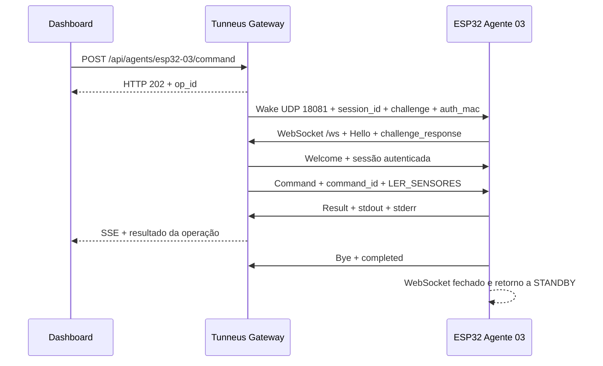

# Protocolo Tunneus v4.1

## Visão Geral

O protocolo Tunneus v4.0 utiliza um modelo híbrido:

1. **UDP Wake**: Gateway acorda o agente ESP32
2. **WebSocket**: Agente conecta de volta e executa comandos

## 2. Fluxo Completo

O exemplo abaixo representa uma leitura do `esp32-03`. O mesmo ciclo é usado pelas demais capabilities, respeitando os argumentos e as regras específicas de cada comando.

1. O operador solicita `LER_SENSORES` no dashboard.
2. O dashboard envia `POST /api/agents/esp32-03/command` com `{"cmd":"LER_SENSORES"}`.
3. O Gateway valida o agente e a capability, cria a operação com um `op_id` e responde HTTP 202. Esse retorno confirma o aceite, não a conclusão da leitura.
4. O Controller cria uma sessão com `session_id` e `challenge` exclusivos e envia o Wake por UDP para o `last_ip` do agente, porta 18081.
5. O ESP32, em `STANDBY`, valida `type`, `agent_id` e `auth_mac`. Se a convocação for válida, passa a `CONNECTING` e abre WebSocket em `ws://<gateway>:18080/ws`.
6. O agente envia `Hello` com o mesmo `session_id` e o `challenge_response` calculado com sua secret.
7. O Gateway valida a sessão e o HMAC, envia `Welcome` e libera a sessão autenticada para o Controller.
8. O Controller envia `Command` com `command_id` igual ao `op_id` e `cmd` igual a `LER_SENSORES`.
9. O firmware realiza uma aquisição nova dos sensores e responde `Result` com os valores em `stdout`; erros, quando existentes, são informados em `stderr`.
10. O Gateway conclui a operação e publica o resultado por SSE. O dashboard interpreta o texto, atualiza as cinco grandezas e acrescenta as amostras aos gráficos locais.
11. O ESP32 envia `Bye` com `reason` igual a `completed`, fecha o WebSocket e retorna a `STANDBY`, permanecendo novamente apenas com o UDP aberto.



HTTP, SSE e WebSocket utilizam TCP 18080; o UDP 18081 é reservado à convocação. Timeouts e tentativas seguem as seções 4 e 5. Para `MOVER`, depois de `command_sent`, a ausência de `Result` não provoca reenvio automático, conforme a seção 5.1.

## 3. Mensagens

### 3.1 Wake (Gateway → ESP32, UDP)

```json
{
  "type": "wake",
  "session_id": "550e8400-e29b-41d4-a716-446655440000",
  "agent_id": "esp32-01",
  "challenge": "a1b2c3d4e5f6...",
  "auth_mac": "hmac_sha256_hex",
  "timestamp": "2026-02-16T12:00:00Z"
}
```

| Campo | Tipo | Descrição |
|---|---|---|
| `type` | string | Sempre `"wake"` |
| `session_id` | string | UUID da sessão |
| `agent_id` | string | ID do agente alvo |
| `challenge` | string | 32 bytes em hex |
| `auth_mac` | string | HMAC-SHA256(challenge \|\| agent_id) |
| `timestamp` | string | ISO 8601 |

### 3.2 Hello (ESP32 → Gateway, WebSocket)

```json
{
  "type": "hello",
  "agent_id": "esp32-01",
  "session_id": "550e8400-e29b-41d4-a716-446655440000",
  "challenge_response": "hmac_sha256_hex",
  "firmware_version": "1.0.0",
  "capabilities": ["LED", "STATUS"]
}
```

*Table 1 – continued*

| Campo | Tipo | Descrição |
|---|---|---|
| `type` | string | Sempre `"hello"` |
| `agent_id` | string | ID do agente |
| `session_id` | string | Mesmo session_id do Wake |
| `challenge_response` | string | HMAC-SHA256(challenge) |
| `firmware_version` | string | Versão do firmware |
| `capabilities` | []string | Comandos suportados |

### 3.3 Welcome (Gateway → ESP32)

```json
{
  "type": "welcome",
  "session_id": "550e8400-e29b-41d4-a716-446655440000",
  "message": "Authenticated successfully"
}
```

### 3.4 Command (Gateway → ESP32)

```json
{
  "type": "command",
  "command_id": "op-uuid",
  "session_id": "550e8400-e29b-41d4-a716-446655440000",
  "cmd": "LED",
  "args": {
    "action": "on",
    "duration_ms": 1000
  }
}
```

| Campo | Tipo | Descrição |
|---|---|---|
| `type` | string | Sempre `"command"` |
| `command_id` | string | ID único do comando |
| `session_id` | string | Sessão atual |
| `cmd` | string | Nome do comando |
| `args` | object | Argumentos (opcional) |

### 3.5 Result (ESP32 → Gateway)

```json
{
  "type": "result",
  "command_id": "op-uuid",
  "session_id": "550e8400-e29b-41d4-a716-446655440000",
  "status": "success",
  "stdout": "LED ligado por 1000ms",
  "stderr": "",
  "exit_code": 0
}
```

*Table 2 – continued*

| Campo | Tipo | Descrição |
|---|---|---|
| `type` | string | Sempre `"result"` |
| `command_id` | string | ID do comando |
| `session_id` | string | Sessão atual |
| `status` | string | `"success"` ou `"error"` |
| `stdout` | string | Saída padrão |
| `stderr` | string | Saída de erro |
| `exit_code` | int | Código de saída (0 = OK) |

### 3.6 Bye (ESP32 → Gateway)

```json
{
  "type": "bye",
  "session_id": "550e8400-e29b-41d4-a716-446655440000",
  "reason": "completed"
}
```

*Table 3 – continued*

| Campo | Tipo | Descrição |
|---|---|---|
| `type` | string | Sempre `"bye"` |
| `session_id` | string | Sessão atual |
| `reason` | string | Motivo do encerramento |

### 3.7 Error (Bidirecional)

```json
{
  "type": "error",
  "code": "AUTH_FAILED",
  "message": "Invalid HMAC signature",
  "session_id": "550e8400-e29b-41d4-a716-446655440000"
}
```

*Table 4 – continued*

| Campo | Tipo | Descrição |
|---|---|---|
| `type` | string | Sempre `"error"` |
| `code` | string | Código do erro |
| `message` | string | Descrição legível |
| `session_id` | string | Sessão (opcional) |

## 4. Timeouts

| Etapa | Timeout | Ação |
|---|---|---|
| Wake → Hello | 10s | Retry ou falha |
| Hello → Welcome | 5s | Fechar conexão |
| Command → Result | 15s | Retry ou falha |
| Sessão ociosa | 60s | Limpar sessão |
| WebSocket geral | 30s | Fechar conexão |

## 5. Retry Policy

- **Máximo de tentativas**: 5
- **Backoff**: 1s, 2s, 4s, 8s, 16s (exponencial)
- **Jitter**: ±20%

## Direção: Gateway → ESP
- `wake` (UDP) — acordar agente
- `welcome` (WS) — autenticação OK
- `command` (WS) — executar comando
- `error` (WS) — erro de protocolo

## Direção: ESP → Gateway
- `hello` (WS) — apresentação + auth
- `result` (WS) — resultado de comando
- `bye` (WS) — encerramento
- `error` (WS) — erro de protocolo

## 6. Segurança

### 6.1 HMAC-SHA256

- `auth_mac` (no Wake) = `HMAC(secret, challenge \|\| agent_id)`
- `challenge_response` (no Hello) = `HMAC(secret, challenge)`
- Secret: 32 bytes, armazenada em base64 no Gateway e hex no ESP32

### 6.2 Validações

1. Verificar `session_id` existe e não expirou
2. Verificar `agent_id` corresponde à sessão
3. Verificar HMAC com `hmac.Equal()` (timing-safe)
4. Verificar timestamp dentro de janela aceitável (±30s)

## 7. Códigos de Erro

| Código | Descrição |
|---|---|
| `AUTH_FAILED` | HMAC inválido |
| `SESSION_EXPIRED` | Sessão expirou |
| `SESSION_NOT_FOUND` | Sessão não existe |
| `INVALID_MESSAGE` | JSON malformado |
| `UNKNOWN_COMMAND` | Comando não suportado |
| `TIMEOUT` | Operação excedeu timeout |
| `AGENT_OFFLINE` | Agente não respondeu ao Wake |
