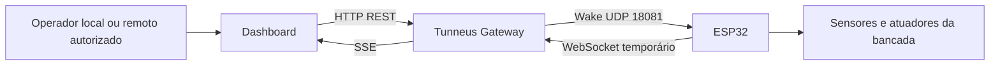

# Tunneus Gateway

Sistema de comunicação e automação **semi-offline** que conecta um dashboard, um Gateway em Go e agentes ESP32 por meio de operações assíncronas e sessões temporárias autenticadas.

**Protocolo Tunneus V4.1 · Dashboard v5.1 · Ecossistema ArcanLab**

> **Finalidade deste repositório:** apresentação técnica do projeto a professores, avaliadores e colaboradores autorizados. O conteúdo é disponibilizado para leitura, avaliação acadêmica e acompanhamento do desenvolvimento. Este repositório não constitui uma distribuição de código aberto; os direitos são reservados e uma eventual licença de distribuição ainda será definida.

## Visão geral

O Tunneus é o projeto central. As bancadas, os protótipos e os agentes físicos são aplicações experimentais utilizadas para demonstrar, testar e validar o sistema, não produtos finais independentes.

O operador escolhe uma capability no dashboard. O Gateway cria uma operação, convoca o agente por UDP, autentica uma sessão WebSocket temporária, envia o comando e publica o resultado por SSE. O ESP32 executa a ação física e retorna ao estado `STANDBY`.



Esse modelo é denominado **Subagente Passivo + Pico de Conexão**: o WebSocket permanece fechado em repouso e existe somente durante a execução da operação.

A arquitetura funciona em rede local sem depender de Internet. O acesso remoto por meio de uma rede privada **Tailscale** já existe e amplia o alcance da operação sem expor diretamente os dispositivos à Internet; essa forma de acesso ainda passa por otimização e aprimoramento.

## Trajetória, experimentos e evidências

O projeto surgiu no ecossistema ArcanLab e evoluiu por ciclos de uma metodologia de 3 etapas: exploração, lapidação e extração. O caderno de campo registra essa trajetória desde a concepção até a primeira versão estável apresentada, preservando decisões, experimentos e resultados do desenvolvimento.

O **Agente 03** é uma das aplicações dessa evolução: uma bancada com sensores e motor de passo utilizada para exercitar comunicação, telemetria e acionamento por meio do mesmo núcleo Tunneus. Os dados históricos registrados no caderno de campo são provenientes da **bancada real**. Em contraste, os valores produzidos pelo Mock Gateway incluído no repositório são **sintéticos** e servem somente à verificação controlada da interface.

**[Ler a trajetória e o papel das bancadas](docs/00-trajetoria-e-bancadas.md)**

## O que está implementado

- Gateway multiagente em Go, com API REST e eventos SSE.
- Operações assíncronas com HTTP 202 e identificação por `op_id`.
- Convocação UDP e sessões WebSocket efêmeras.
- Autenticação por desafio com HMAC-SHA256.
- Registry de agentes, capabilities e endereços.
- Firmware para LED, sensores e motor de passo.
- Dashboard SPA sem bibliotecas externas, com gráficos SVG.
- Operação local e acesso remoto privado via Tailscale, este último em aprimoramento.
- Mock Gateway e verificação da interface com Playwright.

## Documentação

A documentação foi organizada como uma trilha progressiva: primeiro a trajetória, a arquitetura e uma operação completa; depois protocolo, segurança e componentes internos; por fim hardware, telemetria, dashboard, implantação e validação.

**[Abrir o índice completo da documentação](docs/README.md)**

| Atalho | Conteúdo |
|---|---|
| [Trajetória e bancadas](docs/00-trajetoria-e-bancadas.md) | Evolução do projeto, experimentos e origem das evidências |
| [Visão geral](docs/01-visao-geral.md) | Finalidade, agentes e capacidades do sistema |
| [Arquitetura](docs/02-arquitetura.md) | Planos, responsabilidades, canais e portas |
| [Operação ponta a ponta](docs/03-operacao-ponta-a-ponta.md) | Do clique ao gráfico, passo a passo |
| [Protocolo V4.1](docs/05-protocolo.md) | Wake, Hello, Welcome, Command, Result e Bye |
| [Telemetria](docs/10-telemetria.md) | Do sensor ao gráfico no navegador |
| [API e implantação](docs/12-api-e-implantacao.md) | Rotas, rede local, acesso remoto e diagnóstico |
| [Glossário](docs/glossario.md) | Termos empregados no projeto |

## Demonstração controlada sem hardware

O mock reproduz as rotas REST e os eventos SSE do Gateway. Ele não se comunica com dispositivos reais e utiliza somente dados sintéticos. Sua finalidade é permitir que o leitor observe a interface e os contratos de comunicação sem acionar uma bancada.

```bash
python3 tests/dashboard/mock_gateway.py web/dashboard/index.html 18555
```

Abra `http://127.0.0.1:18555/dashboard/` no navegador. É possível solicitar leituras, acompanhar o Pico de Conexão, observar gráficos e exercitar os controles de movimento em ambiente simulado.

## Consulta à execução experimental

Esta seção documenta como a implementação é executada em ambiente autorizado; não representa um pacote de distribuição nem autoriza o uso fora do acompanhamento do projeto.

### Requisitos

- Go compatível com a versão declarada em `go.mod`;
- Arduino IDE e suporte ao ESP32 para os firmwares;
- ArduinoWebsockets, ArduinoJson 6.x e Adafruit BMP085 para o Agente 03;
- Python e Playwright somente para a verificação automatizada do dashboard.

### Configuração

O arquivo `registry.json` é local e não é versionado. O exemplo de configuração pode ser consultado em `configs/registry.example.json`. Secrets demonstrativas, endereços IP e credenciais de firmware devem ser substituídos antes de qualquer utilização em hardware. A secret do Registry é representada em Base64; no firmware, os mesmos bytes são representados em hexadecimal.

### Build e execução

```bash
cp configs/registry.example.json registry.json
go mod tidy
go build -o tunneus-gateway ./cmd/gateway
./tunneus-gateway
```

Em uma instalação configurada, o dashboard fica disponível em `http://localhost:18080/dashboard/` ou no endereço privado correspondente ao Gateway.

### Exemplo de operação

```bash
curl -X POST http://localhost:18080/api/agents/esp32-03/command \
  -H 'Content-Type: application/json' \
  -d '{"cmd":"LER_SENSORES"}'
```

A resposta HTTP 202 confirma o aceite da intenção, não a conclusão da leitura. O desfecho pode ser acompanhado por `/api/events` ou consultado em `/api/operations/{op_id}`.

## Estrutura do repositório

```text
cmd/gateway/          ponto de entrada do Gateway
internal/             Controller, API, Registry, sessões e transportes
agents/esp32/         firmwares e instruções
web/dashboard/        dashboard v5.1
tests/dashboard/      mock e verificação com Playwright
docs/                 apresentação e documentação técnica progressiva
configs/              exemplos demonstrativos de configuração
```

O diretório `cmd/client` preserva um componente histórico da V3 e não integra o build atual.

## Escopo e validação

O Tunneus foi concebido como uma arquitetura semi-offline: preserva o funcionamento local e utiliza conectividade privada para acesso remoto quando necessário. A telemetria atual é sob demanda, e o histórico visual permanece na memória do navegador.

As evidências possuem origens distintas: o caderno de campo documenta experimentos e dados da bancada real; o mock verifica interface e contratos com dados sintéticos. Nenhum dos dois deve ser confundido com uma certificação metrológica, elétrica ou mecânica.

## Autoria

- **Elias Cauã de Souza** — desenvolvimento do projeto
- **Marcelo da Silva dos Santos** — orientação

Instituto Federal Sul-rio-grandense — Campus Novo Hamburgo · Ecossistema ArcanLab.

## Direitos e acesso

Copyright © 2026 Elias Cauã de Souza. **Todos os direitos reservados.**

O acesso ao repositório destina-se a professores, avaliadores e colaboradores autorizados. A disponibilização para leitura não concede direitos de cópia, modificação, redistribuição, sublicenciamento ou comercialização. Consulte o [aviso de direitos](LICENSE) e as [orientações de segurança](SECURITY.md).
