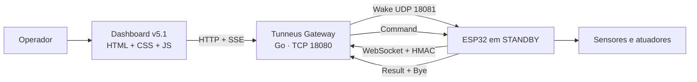

# Tunneus Gateway


> Infraestrutura semi-offline para orquestração local de dispositivos ESP32, com comandos, telemetria sob demanda e um dashboard web sem dependências externas.

O Tunneus conecta um **Gateway em Go** a **agentes ESP32** por uma rede local. O dashboard solicita uma operação, o Gateway convoca o agente por **UDP Wake**, o dispositivo abre uma conexão **WebSocket** temporária, autentica-se por **HMAC-SHA256**, executa o comando e devolve o resultado. Em `STANDBY`, o WebSocket permanece fechado.

Este repositório reúne o Gateway, firmwares de referência, dashboard, documentação e testes com mock. O protótipo não depende de Internet para a operação local principal. O acesso remoto por Tailscale funciona como uma extensão privada e continua em otimização; não é requisito para a comunicação Tunneus na rede local.

**Leitura recomendada:** comece pela [visão geral](docs/01-visao-geral.md) e pela [operação ponta a ponta](docs/03-operacao-ponta-a-ponta.md). Para a especificação das mensagens, consulte o [Protocolo Tunneus v4.1](PROTOCOLO.md). Se quiser localizar qualquer implementação, use o [guia de arquivos](docs/17-guia-de-arquivos.md).

## O que já está implementado

- Wake UDP autenticado na porta 18081.
- Sessões WebSocket temporárias com `Hello`, `Welcome`, `Command`, `Result` e `Bye`.
- Registry persistente de agentes, capabilities e último IP conhecido.
- API HTTP na porta 18080, operações assíncronas e eventos SSE.
- Retries com backoff e tratamento especial para comandos não idempotentes.
- Dashboard v5.1 em HTML, CSS e JavaScript puro, com quatro visões e gráficos SVG locais.
- Firmware do Agente 01 para LED e STATUS.
- Firmware do Agente 03 com BMP180, ACS712, HC-SR04 e motor de passo.
- Mock Gateway e verificações automatizadas do dashboard.
- Acesso remoto via Tailscale já utilizado, com otimização e melhoria operacional ainda em andamento.

## Arquitetura em uma visão



Os agentes não ficam permanentemente conectados por WebSocket. Esse modelo, chamado **Subagente Passivo + Pico de Conexão**, reduz conexões ociosas e mantém cada dispositivo em espera até receber uma convocação válida.

## Estrutura do repositório

```text
tunneus-gateway/
├── cmd/
│   ├── gateway/           # Inicialização do servidor
│   └── client/            # Cliente CLI de teste
├── internal/
│   ├── api/               # REST, SSE e dashboard
│   ├── controller/        # Ciclo de vida das operações
│   ├── protocol/          # Tipos do protocolo
│   ├── registry/          # Cadastro persistente dos agentes
│   ├── session/           # Sessões e challenges
│   ├── wake/              # Convocação UDP
│   └── websocket/         # Autenticação e mensagens WebSocket
├── agents/esp32/          # Firmwares de referência
├── configs/               # Exemplo de registry, sem secrets reais
├── web/dashboard/         # SPA v5.1, sem dependências externas
├── tests/dashboard/       # Mock e verificações do dashboard
├── docs/                  # Documentação didática e decisões técnicas
└── PROTOCOLO.md           # Especificação do protocolo v4.1
```

## Dashboard v5.1

O painel é uma aplicação de página única servida pelo próprio Gateway. Não usa frameworks, CDN nem etapa de build.

| Visão | Função principal |
|---|---|
| **Visão geral** | Agentes, conectividade e envio de comandos |
| **Bancada** | Pressão, corrente, distância, passos e velocidade do Agente 03 |
| **Operações** | Fila, status e resultados das operações |
| **Eventos** | Histórico local dos eventos SSE |

A Bancada mantém até **1.000 amostras ou 24 horas por grandeza**, apenas na memória do navegador. Os gráficos são redesenhados em SVG; recarregar a página limpa as séries.

## Agentes de referência

| Agente | Firmware | Capacidades |
|---|---|---|
| **Agente 01** | V4.3-MARATHON | `LED`, `STATUS` |
| **Agente 02** | Não incluído | Cadastro de referência para polias industriais; sujeito a configuração de hardware e firmware específicos |
| **Agente 03** | V4.4 | `LER_SENSORES`, `LER_PRESSAO`, `LER_CORRENTE`, `LER_DISTANCIA`, `MOVER`, `STATUS`, `START`, `PARE` |

O Agente 03 utiliza BMP180, ACS712, HC-SR04 e driver de motor de passo. As conversões elétricas dependem de calibração; o movimento é em malha aberta e o `Result` de `MOVER` confirma o início da geração de pulsos, não a conclusão física.

## Protocolo em resumo

1. O dashboard envia `POST /api/agents/:id/command`.
2. O Gateway responde `202 Accepted` com um `op_id`.
3. O Controller cria `session_id` e `challenge`, enviando o Wake UDP.
4. O ESP32 valida o Wake e abre WebSocket em `/ws`.
5. O `Hello` comprova a posse da secret por HMAC.
6. O Gateway envia `Welcome` e depois `Command`.
7. O agente responde `Result` e encerra com `Bye`.
8. O SSE informa o desfecho ao dashboard; o agente retorna a `STANDBY`.

Os comandos passam por até cinco tentativas. O `op_id` identifica a operação lógica; cada nova tentativa recebe uma sessão e um challenge novos. Após o envio de `MOVER`, a perda do `Result` não provoca reenvio automático do comando.

## Como executar

### Pré-requisitos

- Go 1.26 ou superior;
- navegador moderno;
- Python 3 apenas para os testes do mock;
- Arduino IDE ou PlatformIO para gravar os firmwares;
- dispositivos na mesma rede local para uma bancada real.

### Gateway

```bash
go build -o bin/gateway ./cmd/gateway
export TUNNEUS_SECRET="$(openssl rand -base64 32)"
./bin/gateway
```

O Gateway escuta em `:18080`. A secret deve ter 32 bytes após a decodificação Base64 e corresponder à secret hexadecimal configurada no firmware. Nunca publique o valor usado na bancada.

O dashboard fica disponível em `http://localhost:18080`. Sem agentes cadastrados e hardware conectado, ele abre normalmente, mas comandos reais não serão executados.

### Cliente CLI

```bash
go build -o bin/tunneus ./cmd/client
./bin/tunneus agent add esp32-01 --caps LED,STATUS --secret "$TUNNEUS_SECRET"
./bin/tunneus agent list
./bin/tunneus cmd esp32-01 STATUS
```

O cliente utiliza `http://localhost:18080`. Para outro endereço, ajuste `apiBase` em `cmd/client/main.go` antes de compilar.

### Firmware

Antes de gravar, configure nos arquivos `.ino`:

- `SUA_REDE_WIFI` e `SUA_SENHA_WIFI`;
- IP do Gateway na rede local;
- `SECRET_HEX` correspondente à secret do Gateway;
- pinagem adequada ao hardware.

Os valores presentes no repositório são **placeholders ou material exclusivamente demonstrativo**. Não representam uma credencial operacional.

### Demonstração sem hardware

```bash
python3 tests/dashboard/mock_gateway.py
```

Abra `http://localhost:18080`. O mock gera leituras sintéticas e não deve ser usado como evidência de medição física.

### Verificações do dashboard

Com o mock em execução:

```bash
python3 tests/dashboard/test_dashboard.py
```

A suíte cobre navegação, envio assíncrono, telemetria, gráficos e limites de armazenamento. Ela contém expectativas de versões anteriores, incluindo o antigo cartão de fluxo; o resultado deve ser interpretado conforme a [nota de verificação](docs/13-verificacao.md).

## Configuração

| Variável/arquivo | Finalidade |
|---|---|
| `TUNNEUS_SECRET` | Secret compartilhada do Gateway |
| `configs/registry.example.json` | Exemplo de cadastro, sem IPs reais |
| `configs/registry.json` | Registry local gerado em runtime; ignorado pelo Git |
| `.env` | Configuração local opcional; ignorada pelo Git |

O Gateway salva o registry no working directory, em `configs/registry.json`. O arquivo de exemplo contém secrets demonstrativas e nunca deve ser usado sem substituição.

## Segurança e limites

- Não há TLS nativo no WebSocket nem na API.
- O Wake depende do `last_ip` conhecido e de conectividade UDP.
- Não existe descoberta automática de agentes.
- A telemetria é sob demanda e não possui persistência no navegador.
- A posição do motor não é realimentada por encoder ou sensor fim de curso.
- A documentação não certifica desempenho elétrico, metrológico ou mecânico.
- A operação local não exige Internet, mas exige energia e a rede local ativa.
- Tailscale e outras soluções de acesso remoto são camadas complementares, não parte do protocolo Tunneus.

## Documentação

- [Visão geral do sistema](docs/01-visao-geral.md)
- [Arquitetura e módulos](docs/02-arquitetura.md)
- [Operação ponta a ponta](docs/03-operacao-ponta-a-ponta.md)
- [Protocolo Tunneus v4.1](PROTOCOLO.md)
- [Autenticação e sessões](docs/06-autenticacao.md)
- [Firmware e hardware](docs/09-firmware-e-hardware.md)
- [Telemetria e gráficos](docs/10-telemetria.md)
- [Dashboard v5.1](docs/11-dashboard.md)
- [API e implantação](docs/12-api-e-implantacao.md)
- [Guia completo de arquivos](docs/17-guia-de-arquivos.md)
- [Mensagens de erro](docs/16-mensagens.md)
- [Glossário](docs/glossario.md)

## Contexto e evolução

O projeto surgiu no ecossistema ArcanLab e evoluiu por ciclos de uma metodologia de 3 etapas: exploração, lapidação e extração. Os documentos distinguem protótipos, bancadas, mock e o Tunneus como projeto central.

O sistema chegou à primeira versão estável apresentada, mas continua em evolução. O acesso remoto via Tailscale já existe e precisa ser otimizado. Não existe, neste repositório, uma distribuição open source nem uma licença de distribuição já decidida: trata-se de material expositivo para professores e colaboradores autorizados.

## Direitos e colaboração

Este repositório é privado e expositivo. A visualização por professores e colaboradores autorizados não implica permissão de redistribuição. Consulte `LICENSE`, `SECURITY.md` e `CONTRIBUTING.md` antes de reutilizar ou alterar o material.
