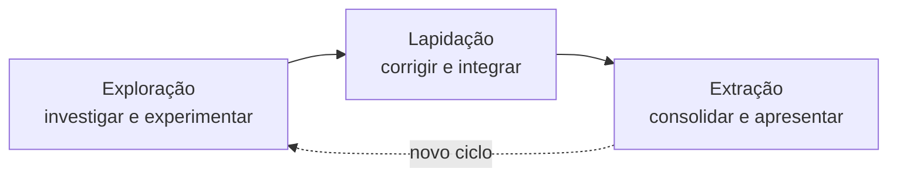

# Trajetória, projeto central e bancadas

Este documento separa a evolução histórica, o Tunneus, os protótipos, os dados reais e o mock. A separação evita apresentar toda bancada como produto final ou toda demonstração como medição física.

## 1. Projeto central

O **Tunneus** é o projeto central: uma infraestrutura de comunicação e operação entre dashboard, Gateway e dispositivos. Protótipos e bancadas têm papel de experimentação, demonstração e teste.

## 2. Evolução por ciclos

O projeto surgiu no ecossistema ArcanLab e evoluiu por uma metodologia de três etapas: exploração, lapidação e extração.

- **Exploração:** montar circuitos, testar hipóteses e compreender restrições.
- **Lapidação:** refinar comunicação, protocolo, firmware e interface.
- **Extração:** transformar o aprendizado em uma versão estável e demonstrável.

## 3. Marcos até a primeira versão estável

 Em síntese, a evolução percorreu as seguintes etapas:

1. Montagem e exploração de sensores e atuadores.
2. Experimentos com ESP32 e comunicação em rede.
3. Construção do Gateway e do modelo de agentes.
4. Consolidação do Wake UDP, WebSocket e autenticação.
5. Desenvolvimento do dashboard e integração das operações.
6. Aplicação dos comandos e leituras no Agente 03.
7. Primeira versão estável apresentada em feira.

O caderno de campo é a fonte dos registros históricos dessa trajetória. Seu conteúdo não é reproduzido integralmente neste repositório.

## 4. Bancada real

Os dados históricos registrados no caderno são da **bancada real**. Quando o dashboard estava conectado ao agente físico, os resultados vinham do firmware e do hardware.

Uma bancada física pode demonstrar funcionamento, mas não equivale automaticamente a certificação elétrica, metrológica ou mecânica.

## 5. Mock Gateway

O mock é um servidor local de demonstração. Ele gera leituras sintéticas de pressão, corrente, distância, passos e velocidade para exercitar o dashboard sem hardware.

| Origem | Natureza dos dados | Uso adequado |
|---|---|---|
| Caderno e registros históricos | Bancada real | Histórico e análise da evolução |
| Agente físico conectado | Resultado do firmware/hardware | Demonstração e teste do sistema |
| Mock Gateway | Dados sintéticos | Teste de interface e protocolo HTTP/SSE |

## 6. Acesso remoto

O acesso remoto via **Tailscale** já funciona, mas precisa ser otimizado e melhorado. Ele é uma camada privada de conectividade, separada do protocolo Tunneus.

## 7. Repositório expositivo

O repositório é destinado à exposição para professores e colaboradores autorizados. Não constitui uma distribuição open source; o licenciamento de distribuição ainda não foi decidido.

## 8. Leitura responsável

- Não tratar o mock como bancada física.
- Não tratar protótipo como certificação.
- Não tratar Tailscale como requisito da operação local.
- Não tratar roadmap como função entregue.
- Não divulgar credenciais, endereços de tailnet ou configurações reais.
