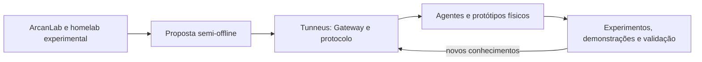

[← Índice da documentação](README.md)

# 0. Trajetória do projeto e papel das bancadas

> **Neste capítulo:** O Tunneus é apresentado como o sistema central da pesquisa. Os protótipos entram como instrumentos de experimentação, e as evidências da bancada real são distinguidas das simulações usadas no dashboard.

## 0.1 Do ArcanLab ao Tunneus

O Tunneus integra o ecossistema **ArcanLab**, voltado a computação distribuída, automação, dispositivos embarcados e infraestrutura de comunicação. A trajetória começou com projetos pessoais e a construção de um homelab para estudos de servidores, redes, Linux e programação. A necessidade de manter serviços e dispositivos funcionando sem dependência integral da Internet consolidou a proposta de uma arquitetura **semi-offline**.

Nesse modelo, a rede local sustenta a operação principal, enquanto a conectividade externa é utilizada quando se deseja acesso remoto. O Tailscale passou a fazer parte dessa infraestrutura como rede privada de acesso, evitando a exposição direta dos serviços administrativos e do sistema à Internet.

O desenvolvimento adotou ciclos iterativos de **Exploração, Lapidação e Extração**. Primeiro, ideias e protótipos são investigados; depois, a solução é reorganizada e aprimorada; por fim, testes, dificuldades e resultados são registrados para orientar o ciclo seguinte.

## 0.2 Marcos da evolução

 Em síntese, a evolução percorreu as seguintes etapas:

| Etapa | Resultado principal |
|---|---|
| Concepção do ArcanLab | Consolidação de um ambiente próprio para estudos, serviços e experimentação. |
| Primeira infraestrutura funcional | Servidor com containers, versionamento, monitoramento, armazenamento e administração remota privada. |
| Formulação da pesquisa | Definição da arquitetura semi-offline, dos objetivos e do papel do Tunneus dentro do ArcanLab. |
| Estudos de acesso remoto | Experimentação com Tailscale, autenticação de dispositivos e restrição do acesso por rede privada. |
| Primeira arquitetura do Tunneus | Definição de Gateway, agentes, sessões, mensagens e comunicação WebSocket. |
| Implementação em Go | Organização modular do Gateway e dos primeiros componentes de comunicação. |
| Testes digitais | Comunicação entre cliente de terminal e Gateway antes da introdução do hardware. |
| Primeiro agente físico | Preparação do firmware e integração de um ESP32 à infraestrutura. |
| Comunicação local com ESP32 | Estabelecimento da comunicação com o Gateway e preparação para experimentos posteriores. |
| Aplicações de bancada | Evolução para agentes com LED, sensores e atuadores, incluindo o Agente 03. |
| Primeira versão estável apresentada | Consolidação do sistema para demonstração em feira e continuidade do desenvolvimento. |

As primeiras versões utilizavam conexões persistentes e heartbeat. A arquitetura atual, descrita nos capítulos seguintes, evoluiu para **Subagente Passivo + Pico de Conexão**, com Wake UDP, sessão WebSocket temporária e autenticação por desafio. Essa diferença mostra que os registros trazem a construção do conhecimento, enquanto a documentação técnica atual descreve o comportamento da versão mais recente.

## 0.3 O projeto não se confunde com seus protótipos

O projeto central é o **Tunneus**. O LED, as polias, os sensores e o motor de passo são aplicações construídas para experimentar o sistema. Eles tornam a arquitetura observável: permitem acompanhar uma intenção no dashboard, a convocação do agente, a autenticação, o comando, o resultado e a ação física.

O **Agente 03** reúne BMP180, ACS712, HC-SR04 e motor de passo. Essa bancada amplia os testes para aquisição de grandezas e acionamento programado, mas continua utilizando o mesmo núcleo multiagente. Alterar o experimento não exige transformar o Gateway em um controlador específico de sensores ou motores.

## 0.4 Origem e interpretação dos dados

| Fonte | Natureza dos dados | Finalidade |
|---|---|---|
| Caderno de campo e registros históricos da pesquisa | Experimentos e dados obtidos na **bancada real**. | Documentar a evolução, as decisões e os resultados experimentais do projeto. |
| Dashboard conectado a um agente físico | Resultados devolvidos pelo firmware em cada operação. | Observar o funcionamento do sistema e as leituras produzidas pela bancada. |
| Mock Gateway incluído no repositório | Valores **sintéticos e controlados**. | Verificar interface, REST, SSE, parser e gráficos sem acionar hardware. |

A distinção é essencial. Os dados da bancada real documentam a experimentação do Tunneus; os dados do mock não são medições físicas. Da mesma forma, uma demonstração funcional não deve ser apresentada, por si só, como certificação metrológica ou caracterização completa do hardware.

## 0.5 Acesso remoto dentro da proposta semi-offline

O funcionamento remoto via **Tailscale** já existe. Na prática, um operador autorizado integra a rede privada e alcança o Gateway sem que o dashboard precise ser exposto diretamente à Internet. O protocolo entre Gateway e agentes permanece o mesmo; o Tailscale atua na conectividade de acesso, não como substituto do Tunneus.

Essa capacidade ainda requer otimização e aprimoramento. A evolução consiste em melhorar a experiência operacional, a robustez e a administração do acesso, preservando a autonomia da rede local e o princípio de que somente pessoas e dispositivos autorizados participem da rede privada.

## 0.6 Fonte histórica

A trajetória foi consolidada a partir do documento **Caderno de campo**, registro cronológico da pesquisa, complementado pelas informações atuais do projeto. O documento original é um material de acompanhamento e não foi incorporado como arquivo binário a este repositório.

---

[Voltar ao índice da documentação](README.md)
