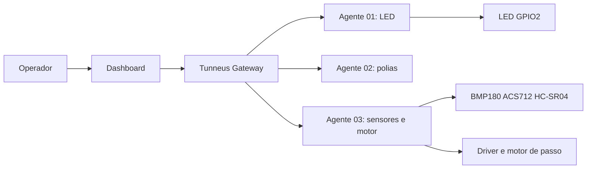

[← Índice da documentação](README.md)

# 1. Visão geral: o que é o Tunneus

> **Neste capítulo:** A finalidade do sistema, o problema resolvido pela
> arquitetura e o papel de cada agente são apresentados antes dos
> detalhes de comunicação.

## 1.1 O sistema em uma frase

O Tunneus é uma camada de mediação entre uma interface de operação e
dispositivos físicos. Ele recebe uma intenção — por exemplo, ler
sensores ou movimentar um motor —, convoca o agente correspondente,
estabelece uma sessão temporária e devolve o resultado à interface.

O sistema pertence ao ecossistema ArcanLab e foi estruturado para
funcionar em rede local, sem depender de Internet. Essa característica
aproxima o projeto de bancadas didáticas e experimentos de laboratório:
a comunicação pode ser observada, os componentes podem ser alterados e
toda a cadeia permanece sob controle do experimento.

**Figura 1** — Visão geral da solução. O operador não acessa diretamente
os dispositivos: todas as intenções passam pelo Gateway, que mantém um
núcleo comum para experimentos diferentes.

## 1.2 O problema resolvido

Cada experimento possui hardware e regras próprias, mas todos precisam
de identidade, endereço, autorização de comando, comunicação e
apresentação do resultado. O Tunneus reúne essas necessidades em um
núcleo comum. O Gateway conhece o nome das capabilities e o formato
estrutural dos argumentos; o firmware conhece o significado físico de
cada comando.

Essa divisão evita duas formas de acoplamento. O Gateway não precisa
saber calcular distância, converter corrente ou gerar pulsos; o
dashboard não precisa abrir sockets para o ESP32. Novos experimentos
podem compartilhar o mesmo ciclo de operação sem transformar o núcleo em
um conjunto de regras específicas de sensores e atuadores.

## 1.3 Agentes e capacidades

**Tabela 1 — Agentes representados no projeto**

| Agente     | Finalidade                                      | Capabilities                                           | Software no repositório                                   |
|------------|-------------------------------------------------|--------------------------------------------------------|-----------------------------------------------------------|
| `esp32-01` | Demonstração compacta com LED.                  | `LED_ON`, `LED_OFF`.                                   | Firmware V4.3-MARATHON.                                   |
| `esp32-02` | Referência para polias industriais com Ponte H. | `LIGAR`, `ELEVAÇÃO A`, `ELEVAÇÃO B`, `DESLIGAR`.       | Cadastro no Registry; firmware não incluído nesta versão. |
| `esp32-03` | Bancada com sensores e motor de passo.          | Leituras, `START`, `PARE` e `MOVER` quando habilitado. | Firmware V4.4.                                            |

> **Capability:** É o nome público de uma ação que o agente pode
> executar. O Registry declara o que está autorizado; o Controller
> verifica essa autorização; o dashboard usa a mesma lista para
> disponibilizar controles; o firmware implementa o comportamento
> físico.

## 1.4 O que a versão atual faz

### Capacidades implementadas

-   Gateway multiagente em Go.
-   Operação assíncrona com HTTP 202.
-   Convocação UDP e WebSocket temporário.
-   Autenticação por HMAC-SHA256.
-   Leituras sob demanda e controle de motor.
-   Eventos SSE e gráficos no navegador.

### Delimitação do experimento

-   Operação em rede local.
-   Sem heartbeat permanente.
-   Sem telemetria contínua para o Gateway.
-   Histórico visual somente no navegador.
-   Descoberta automática e MQTT no roadmap.
-   Validação metrológica como etapa de bancada.

> **Antes de avançar:** O ponto mais importante é a separação de
> responsabilidades: a interface expressa a intenção, o Gateway organiza
> a operação e o agente executa a capability. O próximo capítulo mostra
> como essas responsabilidades formam a arquitetura.
---

[Voltar ao índice da documentação](README.md)
