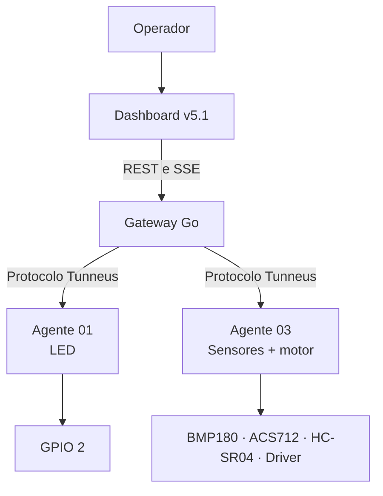

# Visão geral do sistema

O Tunneus Gateway permite que um operador envie comandos a dispositivos ESP32 por meio de um dashboard web. O sistema usa rede local, não exige conexão permanente dos agentes por WebSocket e apresenta resultados de execução e telemetria em tempo real no navegador.

## 1. O problema resolvido

Em uma bancada com microcontroladores, sensores e atuadores, cada dispositivo pode ter pinos, capabilities e limitações próprias. O Tunneus organiza essa operação em quatro partes:

1. **Dashboard:** interface usada pelo operador.
2. **Gateway:** processo central que valida, coordena e registra operações.
3. **Protocolo Tunneus:** mensagens e regras de comunicação.
4. **Agentes ESP32:** firmwares que executam comandos no hardware.

## 2. Premissa semi-offline

A operação principal acontece na rede local. Não há necessidade de nuvem, broker MQTT ou servidor externo para o fluxo Wake → WebSocket → Command → Result.

Isso não significa ausência total de infraestrutura: computador, Gateway e ESP32 precisam de energia, configuração e conectividade IP. O acesso remoto por Tailscale funciona como uma extensão privada em otimização, não como requisito da operação local.

## 3. Subagente Passivo + Pico de Conexão

O agente permanece em `STANDBY`, com o WebSocket desligado. O Gateway envia um Wake UDP autenticado. O ESP32 valida a convocação, conecta-se ao Gateway, autentica a sessão, executa uma operação e encerra a conexão.

Esse modelo evita manter sockets ociosos e concentra a comunicação WebSocket em curtos períodos de atividade. UDP fica disponível para a convocação; isso não elimina a necessidade de Wi-Fi.

## 4. Operações assíncronas

O endpoint de comandos devolve HTTP 202 assim que a operação é aceita. Isso não significa que o hardware já executou o comando. O desfecho chega posteriormente por SSE.

| Identificador | Significado |
|---|---|
| `agent_id` | Dispositivo cadastrado |
| `op_id` | Intenção lógica de comando |
| `session_id` | Tentativa específica de conexão |
| `command_id` | Ligação entre Command e Result; usa o `op_id` |

## 5. Telemetria sob demanda

O sistema não faz streaming contínuo dos sensores. Uma leitura acontece quando um comando é enviado. O firmware devolve texto em `Result.stdout`, o Gateway publica o resultado por SSE e o dashboard transforma as grandezas reconhecidas em amostras locais.

## 6. O que cada versão representa

- **Protocolo v4.1:** especificação das mensagens e regras de comunicação.
- **Firmware V4.3-MARATHON:** Agente 01.
- **Firmware V4.4:** Agente 03.
- **Dashboard v5.1:** interface atual.
- **Go 1.26:** versão declarada no módulo do Gateway.

Esses números identificam componentes diferentes e não devem ser combinados em uma única versão do sistema.

## 7. Limites essenciais

- Sem TLS nativo.
- Sem descoberta automática de agentes.
- Sem persistência das séries do dashboard após recarregar.
- Sem realimentação de posição do motor.
- Sem garantia de conclusão física apenas pelo recebimento de `MOVER`.
- Sem ensaio formal de operação com a WAN desconectada, embora a arquitetura local não dependa de Internet.
- Sem distribuição open source ou licenciamento futuro já decidido.

## 8. Próxima leitura

A [arquitetura](02-arquitetura.md) apresenta os módulos e suas dependências. A [operação ponta a ponta](03-operacao-ponta-a-ponta.md) acompanha um comando completo.
