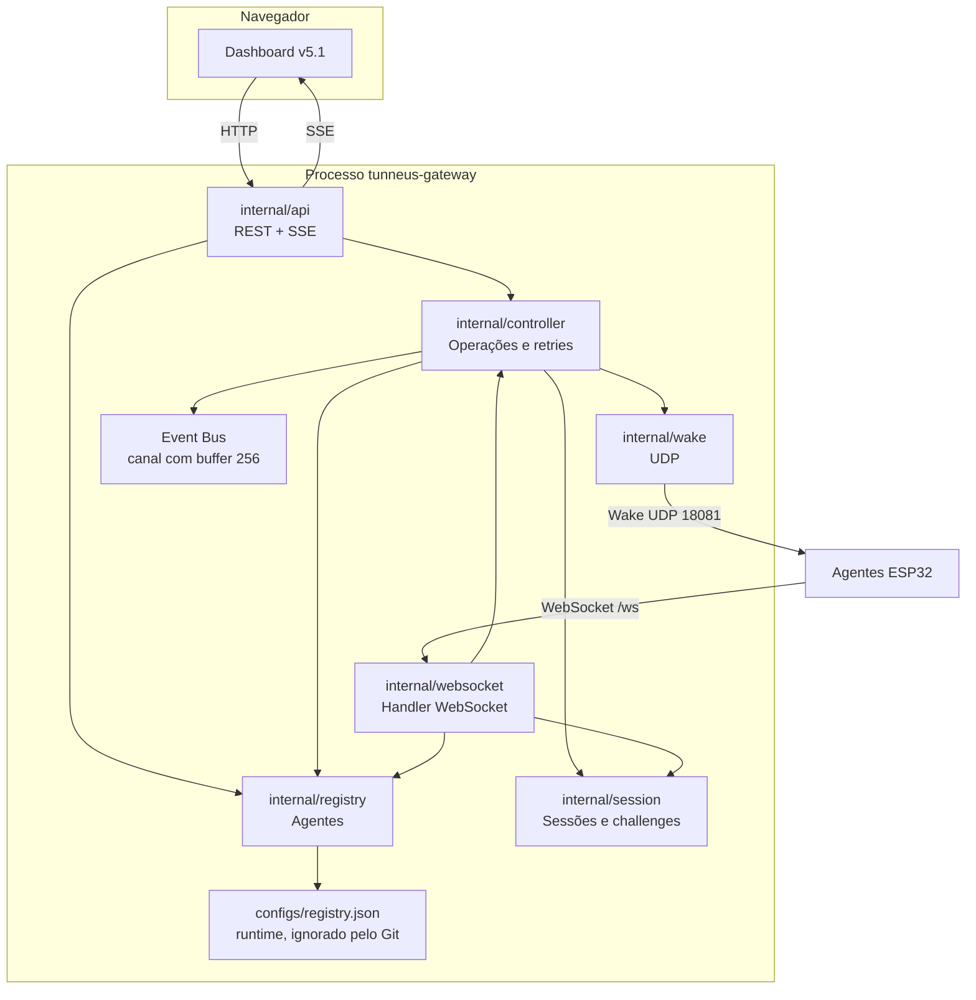

# Arquitetura e módulos

O Gateway segue uma arquitetura modular em processo único. HTTP, SSE, WebSocket, sessões, registry e controller são componentes do mesmo binário Go.

## 1. Diagrama estrutural

## 2. Inicialização

`cmd/gateway/main.go` cria o registry, o Session Store, o Wake Sender e o Controller. Em seguida, instancia o handler WebSocket e a API. O servidor escuta HTTP em `:18080`.

A variável `TUNNEUS_SECRET` é lida na inicialização e repassada ao Wake Sender. O registry é carregado de `configs/registry.json`, relativo ao diretório de trabalho do processo.

## 3. API HTTP

`internal/api/agents.go` oferece:

| Método e rota | Função |
|---|---|
| `POST /api/agents` | Cadastra agente e decodifica a secret Base64 |
| `GET /api/agents` | Lista agentes sem expor secrets |
| `GET /api/agents/{id}` | Consulta um agente |
| `DELETE /api/agents/{id}` | Remove um agente |
| `POST /api/agents/{id}/command` | Cria operação assíncrona |
| `GET /api/events` | Abre stream SSE |
| `GET /` | Serve o dashboard e arquivos estáticos |

O dashboard é incorporado ao binário por `embed.FS`. O handler usa `http.FileServer` com o conteúdo de `web/dashboard`.

## 4. Controller

`internal/controller/controller.go` mantém o mapa de operações, cria sessões, envia Wake, aguarda autenticação, envia Command e aguarda Result.

O mapa `nonIdempotentCmds` identifica `MOVER`. A informação evita reenvio automático depois que o comando foi entregue ao agente.

## 5. Registry

`internal/registry/registry.go` guarda os agentes em memória e grava JSON atomically: primeiro escreve um arquivo temporário e depois executa rename.

Cada agente possui ID, capabilities, secret e `last_ip`. O IP é atualizado quando o WebSocket é autenticado.

## 6. Session Store

`internal/session/session.go` cria sessões com `session_id`, `agent_id`, `challenge`, timestamp e estado de autenticação. O TTL é de 60 segundos e a limpeza ocorre a cada 30 segundos.

## 7. Wake

`internal/wake/wake.go` monta a mensagem UDP, calcula o HMAC e envia ao IP e porta informados. A porta padrão é 18081.

## 8. WebSocket

`internal/websocket/handler.go` faz upgrade da conexão e espera o `Hello`. Após autenticar, registra canais para liberar o Controller e receber o Result. O handler possui um timer geral de 30 segundos.

## 9. Event Bus

O Controller publica eventos em um canal com buffer de 256 posições. Se o canal estiver cheio, o evento é descartado em vez de bloquear a operação. Cada consumidor SSE recebe o stream da API.

## 10. Firmware e dashboard

Os firmwares ficam fora do binário Go e são gravados separadamente. O dashboard é uma SPA única, sem framework, incorporada ao Gateway.

Essa organização facilita a demonstração local, mas concentra disponibilidade e estado operacional em um único processo.
