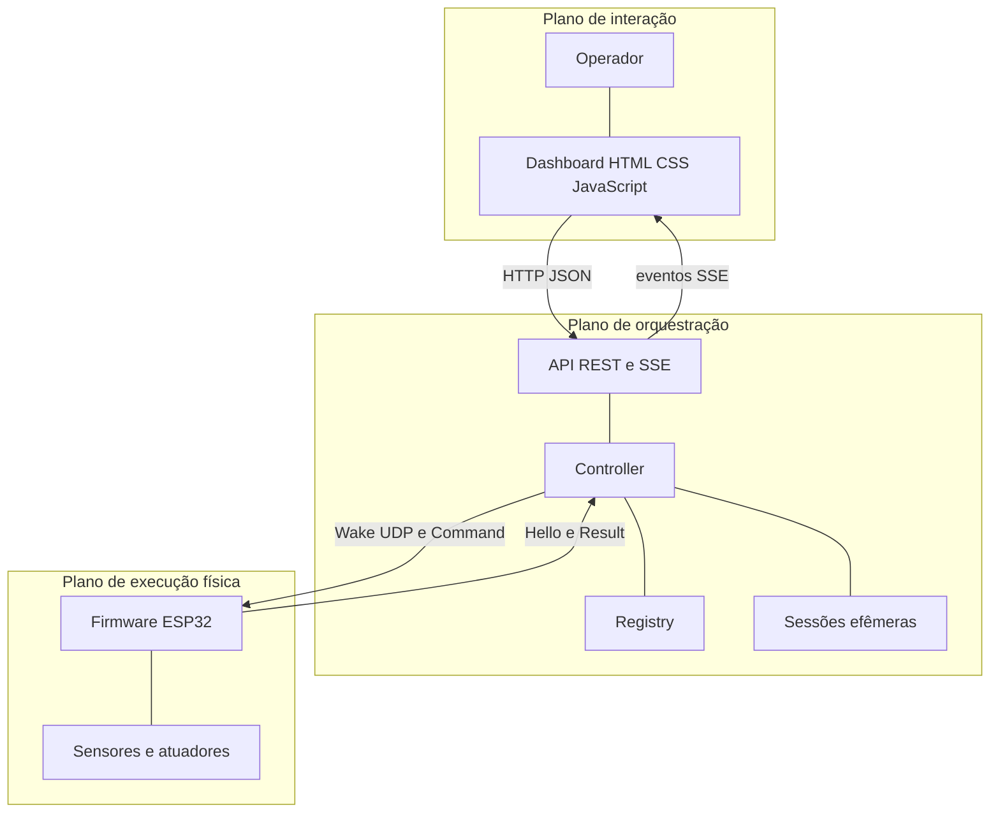
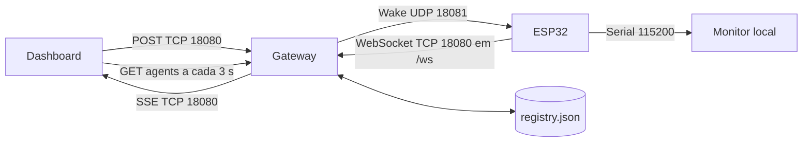

[← Índice da documentação](README.md)

# 2. Arquitetura: quem conversa com quem

> **Neste capítulo:** A arquitetura é dividida em planos, canais e
> responsabilidades. O objetivo é responder onde cada tecnologia atua e
> por que não existe comunicação direta entre navegador e ESP32.

## 2.1 Três planos de responsabilidade

A solução pode ser compreendida em três planos. O plano de **interação**
reúne o operador e o dashboard; o de **orquestração** reúne API,
Controller, Registry, sessões e eventos; o de **execução física** reúne
firmware, sensores e atuadores. As setas entre os planos representam
contratos, não apenas conexões de rede.

**Figura 2** — Arquitetura em camadas. O plano central transforma
intenções em operações e mantém a interface separada das regras físicas
implementadas no firmware.

**Tabela 2 — Responsabilidade de cada plano**

| Plano           | Responsabilidade                                                   | O que não faz                                                   |
|-----------------|--------------------------------------------------------------------|-----------------------------------------------------------------|
| Interação       | Apresentar dados, coletar comandos e acompanhar eventos.           | Não abre WebSocket para o agente e não calcula as medições.     |
| Orquestração    | Validar, identificar, convocar, sincronizar e publicar resultados. | Não interpreta a física de temperatura, distância ou movimento. |
| Execução física | Autenticar-se, executar capabilities e controlar o hardware.       | Não expõe rotas REST nem administra o dashboard.                |

## 2.2 Os quatro canais de comunicação

Embora o sistema pareça uma única conversa, quatro mecanismos participam
de momentos diferentes. HTTP recebe a intenção; SSE informa o andamento
ao navegador; UDP convoca o agente; WebSocket transporta a sessão
autenticada. O Registry em JSON mantém a configuração dos agentes, e o
Serial oferece diagnóstico local.

**Figura 3** — Canais e portas. O UDP é usado apenas para a convocação;
as mensagens Command e Result percorrem o WebSocket aberto pelo próprio
agente.

O acesso remoto via Tailscale acrescenta uma camada de conectividade
privada entre o operador autorizado e o Gateway, sem alterar esses quatro
canais nem criar comunicação direta entre navegador e ESP32. O
funcionamento remoto já existe e está em otimização; a operação local
continua independente de Internet.

**Tabela 3 — Função de cada canal**

| Canal                | Direção             | Conteúdo                                                | Duração                                   |
|----------------------|---------------------|---------------------------------------------------------|-------------------------------------------|
| HTTP REST, TCP 18080 | Cliente → Gateway   | Listagens, comandos e consulta de operação.             | Resposta HTTP imediata; POST retorna 202. |
| SSE, TCP 18080       | Gateway → navegador | Criação, Wake, autenticação, envio, resultado e falhas. | Stream por cliente, com reconexão.        |
| UDP 18081            | Gateway → ESP32     | Wake com sessão, challenge e MAC.                       | Um datagrama por tentativa.               |
| WebSocket, TCP 18080 | ESP32 ↔ Gateway     | Hello, Welcome, Command, Result e Bye.                  | Somente durante o Pico de Conexão.        |

## 2.3 Multiagente no núcleo, especialização na bancada

O núcleo não foi limitado a um único dispositivo. Cada operação carrega
um `agent_id`, e o Registry pode conter vários agentes com capabilities
diferentes. O dashboard v5.1, por sua vez, é especializado no Agente 03
e apresenta cinco grandezas e controles de movimento. Essa
especialização da interface não reduz a capacidade multiagente do
Gateway.

O painel utiliza `esp32-03` por padrão e aceita o parâmetro
`?agent=<id>`. Ele filtra os eventos pelo agente selecionado, mas não se
transforma automaticamente em uma interface genérica para qualquer
hardware. Essa escolha mantém a apresentação da bancada clara e preserva
a independência entre núcleo e experimento.

> **Modelo mental da arquitetura:** HTTP inicia, SSE acompanha, UDP
> convoca e WebSocket executa a conversa autenticada. Com esses quatro
> papéis separados, já é possível acompanhar uma operação completa.
---

[Voltar ao índice da documentação](README.md)
