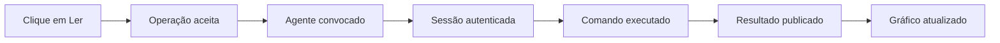
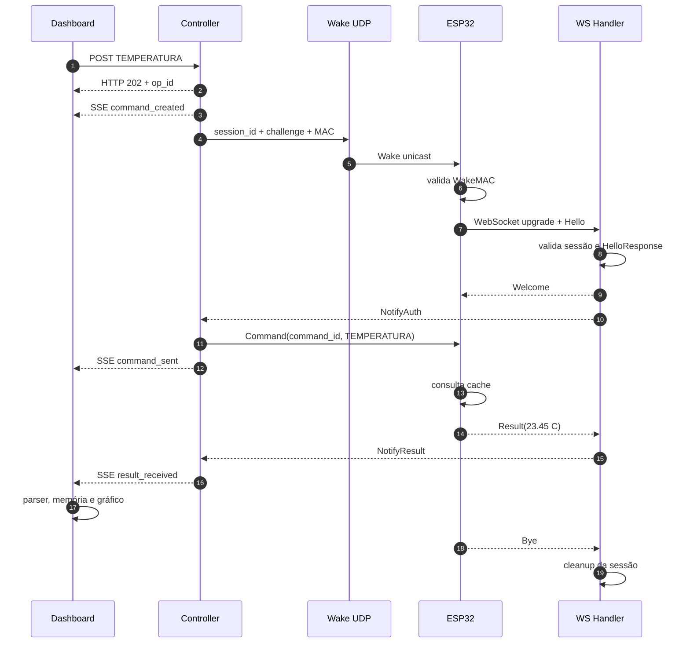
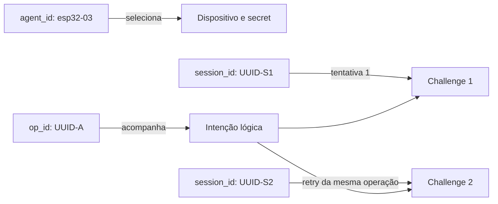

[← Índice da documentação](README.md)

# 3. Uma operação de ponta a ponta

> **Exemplo guiado:** Uma leitura de `TEMPERATURA` no Agente 03 será
> acompanhada desde o clique até a atualização do gráfico. Esse exemplo
> funciona como referência para todos os capítulos seguintes.

## 3.1 Primeiro, o percurso sem detalhes internos

Ao clicar em “Ler” no cartão de temperatura, o operador não recebe
imediatamente o valor do sensor. Primeiro, o Gateway aceita a intenção e
cria uma operação. Depois, convoca o agente, autentica uma sessão,
entrega o comando e aguarda o Result. Somente quando esse resultado
retorna por SSE o dashboard cria a amostra. 

**Figura 4** — Percurso simplificado de uma leitura. O aceite acontece
antes da comunicação com o agente; o valor aparece apenas depois do
Result e do processamento no navegador.

## 3.2 O mesmo exemplo, agora passo a passo

1.  **Intenção.** O dashboard envia `POST /api/agents/esp32-03/command`
    com `{"cmd":"TEMPERATURA"}`.
2.  **Validação.** O Controller verifica se o agente existe e se a
    capability está cadastrada no Registry.
3.  **Aceite assíncrono.** Uma operação recebe UUID e é armazenada. A
    API responde HTTP 202 com `op_id`, enquanto a execução continua em
    uma goroutine.
4.  **Convocação.** O Gateway cria `session_id` e challenge, calcula o
    WakeMAC e envia o Wake por UDP ao último IP conhecido do agente.
5.  **Resposta do dispositivo.** O ESP32 valida o Wake, abre WebSocket
    para `/ws` e envia Hello com a resposta HMAC do challenge.
6.  **Autenticação.** O handler verifica sessão, identidade e
    HelloResponse. Se tudo for válido, envia Welcome e avisa ao
    Controller.
7.  **Execução.** O Controller envia Command com o `command_id` da
    operação. O firmware consulta o valor de temperatura em seu cache.
8.  **Resultado.** O agente responde, por exemplo, `stdout: "23.45 C"`.
    O Controller publica `result_received` por SSE.
9.  **Apresentação.** O dashboard confere número e unidade, registra a
    amostra na memória e redesenha o gráfico.
10. **Encerramento.** O agente envia Bye, os recursos da sessão são
    liberados e o ESP32 retorna a STANDBY com UDP ativo.

**Tabela 4 — O que cada etapa comprova**

| Marco             | O que significa                                   | O que ainda não significa                                  |
|-------------------|---------------------------------------------------|------------------------------------------------------------|
| HTTP 202          | A intenção foi aceita e recebeu um identificador. | Não comprova que o agente recebeu ou executou o comando.   |
| `wake_sent`       | O Controller entrou na etapa de convocação.       | Não comprova que o ESP32 validou o Wake.                   |
| `auth_ok`         | O Hello foi validado e a sessão está autenticada. | Não comprova que a capability já foi executada.            |
| `command_sent`    | O Command foi escrito no WebSocket.               | Não é o resultado da operação.                             |
| `result_received` | O Result chegou ao Controller e foi publicado.    | Em MOVER, confirma o início, não a conclusão do movimento. |

## 3.3 Sequência completa da comunicação

A figura seguinte acrescenta os componentes que participam da conversa.
O Controller coordena a operação; o Wake Sender transmite o datagrama; o
WebSocket Handler autentica e recebe mensagens; o dashboard acompanha os
eventos. O retorno HTTP 202 ocorre no início, sem aguardar as etapas
seguintes.

**Figura 5** — Sequência nominal de uma leitura. A mesma ordem se aplica
a outras capabilities; mudam o comando, os argumentos e o processamento
executado pelo firmware.

## 3.4 Três identificadores que não devem ser confundidos

Durante o exemplo, três identificadores aparecem com finalidades
distintas. O agente continua sendo o mesmo durante todo o experimento; a
operação representa uma intenção; a sessão representa uma tentativa de
conexão. Se houver retry, a operação permanece, mas a sessão e o
challenge são renovados.

**Figura 6** — Identidade do dispositivo, da operação e das tentativas.
Um retry cria uma nova sessão sem alterar o op_id da intenção original.

**Tabela 5 — Identificadores e seus ciclos de vida**

| Campo                  | Identifica                                 | Quando muda                                          |
|------------------------|--------------------------------------------|------------------------------------------------------|
| `agent_id`             | Dispositivo cadastrado e sua configuração. | Permanece fixo para o agente.                        |
| `op_id` / `command_id` | Intenção lógica solicitada pelo cliente.   | É criado na submissão e permanece igual nos retries. |
| `session_id`           | Tentativa episódica de conexão.            | É renovado em cada tentativa.                        |

> **Resumo do percurso:** O clique cria uma operação; a operação cria
> uma ou mais sessões; a sessão transporta um Command e um Result; o SSE
> informa o andamento; o dashboard transforma o resultado em informação
> visual.
---

[Voltar ao índice da documentação](README.md)
