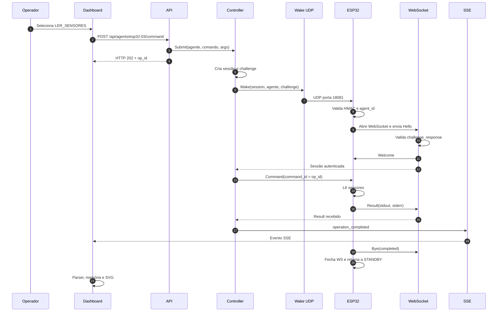

# Operação ponta a ponta

Esta seção acompanha uma leitura completa do Agente 03, desde o clique até o gráfico.

## 1. Cenário

- Agente: `esp32-03`.
- Comando: `LER_SENSORES`.
- Gateway: TCP 18080.
- Wake: UDP 18081.
- Registry: agente cadastrado com capability compatível e `last_ip` conhecido.

## 2. Sequência completa

## 3. Aceite da operação

O POST retorna imediatamente com 202 e um `op_id`. O dashboard acrescenta a operação como pendente. O Controller trabalha em goroutine, permitindo que a API atenda outras requisições.

## 4. Convocação

O Controller usa o `last_ip` do registry. Se não houver IP, a operação falha antes do Wake. O ESP32 em `STANDBY` recebe o pacote, valida o HMAC e inicia a conexão WebSocket.

## 5. Autenticação e execução

O `Hello` associa o dispositivo à sessão. O Gateway verifica o HMAC com comparação timing-safe. O `Welcome` libera a etapa de comando.

Em `LER_SENSORES`, o firmware realiza aquisição nova e devolve as cinco grandezas em uma linha de `stdout`.

## 6. Encerramento e apresentação

O Controller publica o resultado por SSE. O dashboard reconhece o texto, atualiza cartões, adiciona pontos e desenha os gráficos. O `Bye` fecha a sessão de rede.

## 7. Exceções

| Falha | Efeito |
|---|---|
| Sem `last_ip` | Operação falha antes do Wake |
| Wake não recebido | Nova tentativa dentro da política de retry |
| Hello não chega | Timeout de autenticação |
| Result não chega | Timeout de execução ou regra não idempotente |
| SSE desconecta | Navegador tenta reconectar; operação não é cancelada |

## 8. Particularidade do motor

`MOVER` devolve Result ao iniciar a geração de pulsos. O movimento pode continuar depois de Bye e não possui confirmação física de conclusão.
