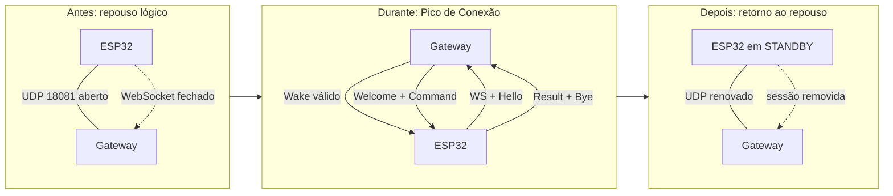
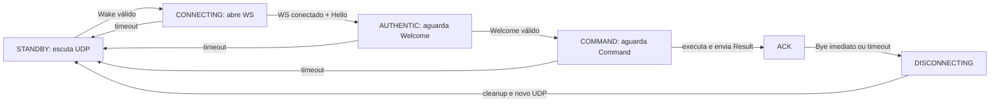

[← Índice da documentação](README.md)

# 4. Subagente Passivo e Pico de Conexão

> **Neste capítulo:** O comportamento do agente antes, durante e depois
> da operação é apresentado como uma máquina de estados. O conceito de
> STANDBY ganha um significado preciso.

## 4.1 Por que o agente é chamado de passivo

O agente é passivo em relação à **convocação**: não mantém uma conexão
permanente aguardando comandos. Em STANDBY, o WebSocket está fechado e o
socket UDP permanece atento. Depois de receber um Wake válido, porém, o
agente deixa de ser passivo na direção da conexão e abre ativamente o
WebSocket para o Gateway.

Esse modelo elimina heartbeats da arquitetura vigente. Em vez de gastar
tráfego para afirmar continuamente que está disponível, o dispositivo
comprova sua conectividade ao autenticar uma sessão quando existe
trabalho a executar.

**Figura 7** — Antes, durante e depois do Pico de Conexão. O WebSocket
existe somente no intervalo necessário para autenticar, executar e
responder.

> **STANDBY não significa offline:** STANDBY representa repouso lógico:
> UDP ativo e WebSocket fechado. Como não existe heartbeat, esse estado
> não é uma prova contínua de alcance de rede. A prova efetiva ocorre
> quando uma nova sessão é autenticada.

## 4.2 A máquina de estados do firmware

Os dois firmwares seguem a mesma sequência lógica. Cada estado possui
uma função e um tempo máximo. Se a conversa não avançar, o firmware
executa cleanup e retorna ao repouso, em vez de permanecer
indefinidamente em uma conexão incompleta.

**Figura 8** — Máquina de estados do subagente. O motor do Agente 03 é
atualizado fora dessa máquina de rede e pode continuar gerando pulsos
após o retorno a STANDBY.

**Tabela 6 — Leitura prática dos estados**

| Estado              | Atividade principal                    | Transição esperada                |
|---------------------|----------------------------------------|-----------------------------------|
| STANDBY             | Escuta Wake e executa tarefas locais.  | Wake válido → CONNECTING.         |
| CONNECTING          | Tenta abrir WebSocket e envia Hello.   | Conexão estabelecida → AUTHENTIC. |
| AUTHENTIC           | Aguarda o Welcome do Gateway.          | Welcome → COMMAND.                |
| COMMAND             | Recebe, valida e executa a capability. | Result enviado → ACK.             |
| ACK / DISCONNECTING | Envia Bye e libera recursos.           | Cleanup → STANDBY.                |

## 4.3 Recursos que nascem e desaparecem com a sessão

No Gateway, a sessão contém UUID, challenge, commandID, estado textual,
canais de sincronização, conexão e IP remoto. O Controller cria essa
sessão depois que o envio do Wake não retorna erro local. O WebSocket
Handler associa a conexão somente depois da autenticação.

A remoção ocorre em sucesso, timeout, Bye e finalização do handler. Além
disso, o Ephemeral Store elimina sessões com mais de 60 s em varreduras
realizadas a cada 30 s. No ESP32, o cleanup fecha o WebSocket, recria os
objetos de rede e volta a escutar UDP. Os dois lados participam da
liberação de recursos.

> **Rede e física possuem ciclos diferentes:** No Agente 03, a sessão
> pode terminar enquanto o motor continua seu movimento programado. O
> término do WebSocket significa apenas que a comunicação foi encerrada;
> não é um comando de parada do atuador.
---

[Voltar ao índice da documentação](README.md)
