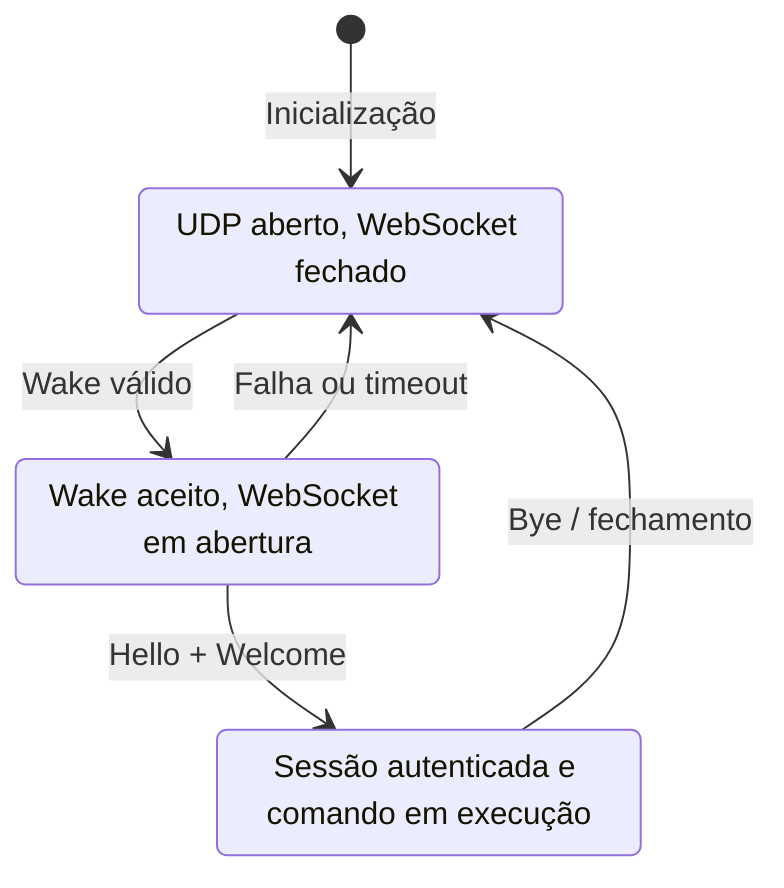

# Subagente Passivo + Pico de Conexão

O modelo define dois estados principais para o ESP32: espera passiva e conexão temporária.

## 1. Estados

## 2. STANDBY

O dispositivo permanece associado à rede Wi-Fi e escuta UDP. Não mantém WebSocket conectado. Sensores podem ser atualizados localmente pelo firmware, mesmo sem uma operação de rede ativa.

## 3. Pico de conexão

Depois de um Wake válido, o agente:

1. abre o WebSocket;
2. envia Hello;
3. recebe Welcome;
4. recebe Command;
5. envia Result;
6. envia Bye;
7. fecha o socket.

O Gateway controla os timeouts e a validade da sessão.

## 4. Justificativas

- Reduz conexões WebSocket ociosas.
- Evita reconexão permanente em dispositivos sem trabalho.
- Torna explícita a autenticação de cada sessão.
- Permite operação local sem serviço externo.

## 5. Custos e restrições

- O Wake precisa alcançar o IP atual.
- UDP não garante entrega; o Controller precisa de retries.
- A abertura da conexão adiciona latência.
- Em redes com isolamento de clientes, o fluxo pode falhar.
- O agente ainda consome energia e Wi-Fi em STANDBY.

## 6. O que não muda no hardware

O encerramento do WebSocket não desliga sensores nem interrompe necessariamente a rotina do motor. No Agente 03, os pulsos podem continuar após o Bye.
