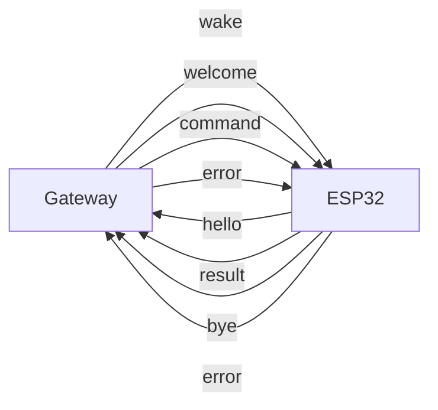

# Protocolo Tunneus v4.1

A especificação normativa das mensagens está em [PROTOCOLO.md](../PROTOCOLO.md). Este capítulo explica como interpretá-la.

## 1. Canais

| Canal | Porta | Uso |
|---|---|---|
| HTTP REST | TCP 18080 | API e dashboard |
| SSE | TCP 18080 | Eventos para o navegador |
| WebSocket | TCP 18080 | Sessão temporária do agente |
| UDP Wake | UDP 18081 | Convocação do agente |

## 2. Famílias de mensagens

`wake` usa UDP. As demais mensagens operacionais usam WebSocket.

## 3. Envelopes

Todas as mensagens usam JSON e um campo `type`. A sessão é identificada por `session_id`; o comando usa `command_id`.

No firmware de referência, o `command_id` é comparado à sessão ativa. O Gateway usa o `op_id` como `command_id` do Command.

## 4. Result

O Result contém:

- `status`: `success` ou `error`;
- `stdout`: saída textual;
- `stderr`: erro textual;
- `exit_code`: código numérico.

O dashboard interpreta formatos textuais específicos de `stdout`. O protocolo transporta texto; a semântica das grandezas pertence ao firmware e ao parser.

## 5. Error

Erros possuem código, mensagem e, quando aplicável, sessão. Um erro de protocolo não deve ser confundido com HTTP 202 ou com `status: error` de um Result.

## 6. Compatibilidade

Uma capability cadastrada não garante que qualquer firmware aceite os mesmos argumentos. O contrato completo depende da versão do protocolo, do firmware e do parser do dashboard.
