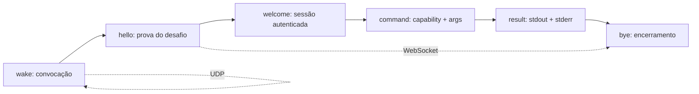

[← Índice da documentação](README.md)

# 5. Protocolo Tunneus V4.1

> **Neste capítulo:** Depois de acompanhar o percurso completo, cada
> mensagem passa a ser examinada pelo seu formato, direção e função. O
> protocolo é o vocabulário comum entre Gateway e firmware.

## 5.1 Seis mensagens, uma conversa curta

As mensagens são JSON textual. O campo `type` seleciona a estrutura
seguinte, e os demais campos carregam identidade, autenticação, comando
ou resultado. A conversa nominal utiliza seis tipos: Wake, Hello,
Welcome, Command, Result e Bye.

**Figura 9** — Vocabulário do protocolo. O Wake viaja por UDP; os cinco
tipos seguintes utilizam o WebSocket temporário.

**Tabela 7 — Mensagens, campos e finalidade**

| Tipo      | Direção            | Campos principais                                      | Função                                                   |
|-----------|--------------------|--------------------------------------------------------|----------------------------------------------------------|
| `wake`    | Gateway → ESP, UDP | `agent_id`, `session_id`, `challenge`, `auth_mac`.     | Convocar e comprovar conhecimento da secret.             |
| `hello`   | ESP → Gateway, WS  | Identidades, `challenge_response`, `agent`, `version`. | Apresentar a sessão e responder ao desafio.              |
| `welcome` | Gateway → ESP, WS  | `session`, `authenticated`.                            | Confirmar autenticação e habilitar a espera por Command. |
| `command` | Gateway → ESP, WS  | `command_id`, `cmd`, `args?`.                          | Solicitar uma capability.                                |
| `result`  | ESP → Gateway, WS  | `command_id`, `stdout`, `stderr`.                      | Entregar o resultado textual.                            |
| `bye`     | ESP → Gateway, WS  | `session_id`, `reason`.                                | Encerrar a sessão e indicar o motivo.                    |

## 5.2 Wake: a convocação autenticada

Para cada tentativa, o Gateway gera 32 bytes criptograficamente
aleatórios e os representa em 64 caracteres hexadecimais. Também cria um
novo UUID de sessão. O campo `auth_mac` autentica a concatenação
`challenge || agent_id`, sem separador. O pacote é enviado ao `last_ip`
cadastrado, porta UDP 18081.

    {
      "type":"wake",
      "agent_id":"esp32-03",
      "session_id":"UUID-DA-TENTATIVA",
      "challenge":"64_CARACTERES_HEX",
      "auth_mac":"HMAC_SHA256_EM_HEX"
    }

O firmware confere tipo, identidade e campos, rejeita uma sessão já
presente em seu pequeno cache e recalcula o HMAC. Se a verificação for
aceita, armazena sessão e challenge, fecha temporariamente a escuta UDP
e entra em CONNECTING.

## 5.3 Hello e Welcome: a sessão é comprovada

O Hello deve ser a primeira mensagem depois do upgrade WebSocket. Ele
repete agente e sessão e apresenta
`challenge_response = HMAC-SHA256(secret, challenge)`. O handler procura
uma sessão pendente, busca a secret do agente no Registry e compara os
códigos com `hmac.Equal`.

Quando a validação é concluída, o handler associa a conexão à sessão,
envia Welcome e chama `NotifyAuth`. Esse aviso libera a espera do
Controller, que então pode enviar o Command. O campo `version` informa o
firmware, mas não há negociação automática de versão no envelope.

## 5.4 Command e argumentos opcionais

A V4.1 acrescenta `args` sem quebrar comandos antigos. Quando o mapa
está ausente ou vazio, o campo é omitido do JSON. O Gateway valida
apenas a estrutura; regras como direção, velocidade e quantidade de
passos pertencem ao firmware.

**Tabela 8 — Limites estruturais de args no Gateway**

| Regra              | Limite                           | Exemplo                                |
|--------------------|----------------------------------|----------------------------------------|
| Número de campos   | Até 8.                           | `dir`, `steps`, `speed`.               |
| Nome do campo      | 1 a 24 caracteres.               | Chaves curtas e explícitas.            |
| Tipos aceitos      | String, número JSON ou booleano. | Objetos, listas e null são recusados.  |
| String             | Até 32 caracteres.               | `"direita"`, `"normal"`.               |
| Serialização total | Até 256 bytes.                   | HTTP 400 antes da operação se exceder. |

    {"type":"command","command_id":"UUID_DA_OPERACAO",
     "cmd":"MOVER","args":{"dir":"direita","steps":200,"speed":"normal"}}

No Agente 03, `MOVER` exige direção `direita` ou `esquerda`, passos
inteiros entre 1 e 30000 e velocidade `lenta`, `normal` ou `rapida`. A
validação ocorre antes de alterar DIR ou PUL.

## 5.5 Result e Bye: retorno e encerramento

O Result utiliza o mesmo `command_id` do Command e separa dois canais
textuais. `stdout` carrega o valor ou a descrição de sucesso; `stderr`
explica uma recusa ou condição inválida. Essa separação permite que o
dashboard diferencie uma amostra válida de uma ocorrência sem número.

    {"type":"result","command_id":"UUID_DA_OPERACAO",
     "stdout":"23.45 C","stderr":""}

O Bye contém sessão e motivo. O Agente 01 envia Bye imediatamente após
Result. O Agente 03 aguarda até 5 s na etapa ACK e utiliza `ack_timeout`
quando encerra por tempo. Nos dois casos, a sessão é removida e o
dispositivo retorna à escuta UDP. **Em síntese:** Wake convoca; Hello
responde ao desafio; Welcome libera a conversa; Command solicita; Result
devolve; Bye encerra.

## Código e referências relacionadas

- [Especificação original](../PROTOCOLO.md)
- [Mensagens e argumentos](../internal/protocol/command.go)

---

[Voltar ao índice da documentação](README.md)
