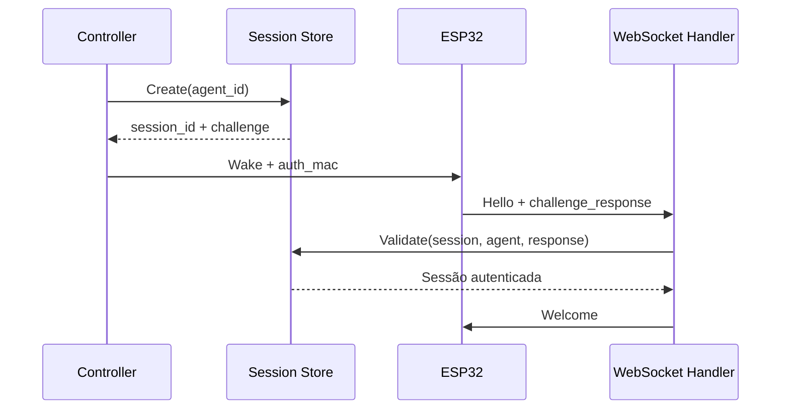

# Autenticação, sessões e identidade

O Tunneus usa segredo compartilhado por agente e HMAC-SHA256 para autenticar a convocação e o Hello.

## 1. Secret

No Gateway, a secret é cadastrada em Base64 e decodificada para bytes. No firmware ESP32, os mesmos bytes são representados em hexadecimal.

Base64 e hexadecimal são codificações diferentes. Comparar as strings diretamente produziria erro; é necessário comparar os bytes decodificados.

## 2. Dois HMACs diferentes

```text
WakeMAC       = HMAC-SHA256(secret, challenge || agent_id)
HelloResponse = HMAC-SHA256(secret, challenge)
```

O Wake autentica a convocação para um agente. O Hello comprova que quem abriu o WebSocket conhece a secret e respondeu ao challenge da sessão.

## 3. Ciclo de sessão



## 4. TTL e limpeza

O TTL da sessão é 60 segundos. A limpeza periódica ocorre a cada 30 segundos. O timer geral do handler WebSocket é de 30 segundos após autenticação.

Esses mecanismos são complementares: TTL controla o registro da sessão; o timer limita a conexão.

## 5. Retry e identidade

Um retry preserva o `op_id`, mas cria nova sessão e novo challenge. Resultados de sessões antigas não devem ser aceitos como se pertencessem à tentativa atual.

## 6. Limites de segurança

- Não há confidencialidade sem TLS.
- A secret compartilhada precisa ser protegida nos dois lados.
- O registry real não deve ser publicado.
- A demonstração usa secret fictícia claramente identificada.
- Se uma secret real for exposta, deve ser rotacionada, não apenas removida do arquivo.

## 7. Acesso remoto

Tailscale não substitui o HMAC do protocolo. Ele controla conectividade privada entre máquinas; o Tunneus continua autenticando suas próprias sessões.
