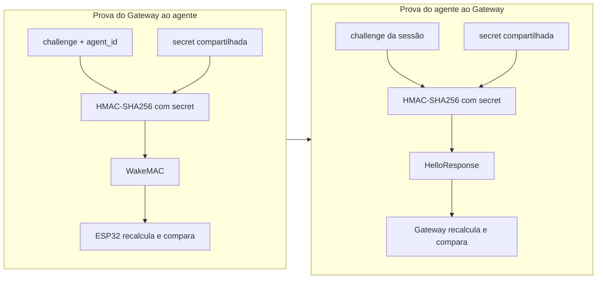
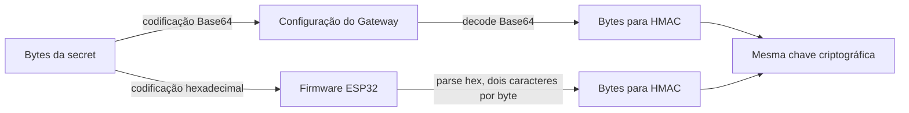

[← Índice da documentação](README.md)

# 6. Autenticação e segurança da sessão

> **Pergunta central:** Como o agente reconhece uma convocação do
> Gateway e como o Gateway reconhece o agente correto? A resposta está
> em duas provas HMAC calculadas com a mesma secret, mas sobre mensagens
> diferentes.

## 6.1 Uma dupla verificação

Antes de qualquer WebSocket, o agente precisa verificar se o Wake
realmente veio de quem conhece sua secret. Depois, o Gateway verifica se
o dispositivo que abriu o WebSocket conhece o challenge daquela sessão.
As duas verificações são independentes e utilizam HMAC-SHA256.

**Figura 10** — Dupla autenticação por desafio. O WakeMAC cobre
challenge e identidade; o HelloResponse cobre somente o challenge.

    WakeMAC      = HMAC-SHA256(secret, challenge || agent_id)
    HelloResponse = HMAC-SHA256(secret, challenge)

A concatenação não contém separador. O secret é a chave do algoritmo; o
desafio é o dado que muda a cada tentativa. Assim, as respostas de uma
sessão não são simplesmente reutilizadas em outra, pois cada tentativa
recebe um novo challenge.

## 6.2 A mesma chave em duas representações

Um detalhe de configuração conecta os dois lados. No Gateway, a secret
do agente é armazenada como texto Base64 e decodificada para bytes antes
do cálculo. No firmware, os mesmos bytes são escritos como pares
hexadecimais. Base64 e hexadecimal são representações diferentes, não
duas chaves diferentes.

**Figura 11** — Equivalência das representações da secret. A comparação
correta acontece depois da decodificação, byte a byte.

> **Como conferir a configuração:** Decodifica-se a Base64 do Gateway e
> codificam-se os bytes do firmware em hexadecimal, ou decodificam-se
> ambos para bytes. Comparar diretamente as duas strings produziria um
> falso diagnóstico, porque elas foram feitas para parecer diferentes.

## 6.3 Onde cada verificação acontece

**Tabela 9 — Controles aplicados durante a abertura da sessão**

| Momento               | Verificação                                                 | Resultado esperado                                      |
|-----------------------|-------------------------------------------------------------|---------------------------------------------------------|
| Recepção do Wake      | Tipo, agente, campos, sessão não repetida e WakeMAC.        | Somente uma convocação válida inicia o WebSocket.       |
| Recepção do Hello     | Sessão pendente, agente cadastrado e resposta ao challenge. | A conexão é associada à sessão correta.                 |
| Comparação no Gateway | `hmac.Equal` sobre os MACs calculados e recebidos.          | A autenticação não depende de comparação textual comum. |
| Associação da conexão | Estado da sessão e IP remoto.                               | O Controller passa a enxergar a sessão autenticada.     |

## 6.4 Relação entre autenticação e transporte

O HMAC comprova conhecimento da secret e vincula as mensagens ao
desafio. O WebSocket e o UDP fornecem o transporte. A arquitetura
utiliza explicitamente esses mecanismos em seu contexto de bancada e
laboratório; a exposição pública exigiria uma política de rede e
proteção de transporte adequada ao ambiente.

No projeto, as secrets ficam fora das mensagens: o que circula são
códigos derivados. O documento também não reproduz credenciais reais. A
descrição se concentra no mecanismo e na forma de configurar e verificar
o par Gateway–firmware.

## Código e referências relacionadas

- [Validação HMAC no Registry](../internal/registry/registry.go)
- [Autenticação WebSocket](../internal/websocket/handler.go)

---

[Voltar ao índice da documentação](README.md)
