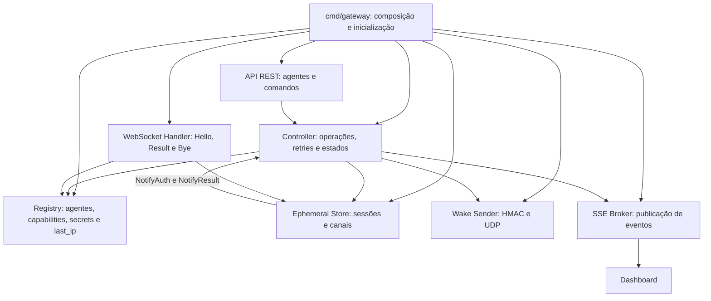
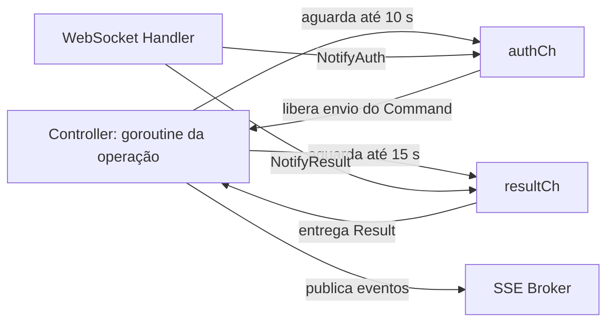

[← Índice da documentação](README.md)

# 7. O Gateway por dentro

> **Neste capítulo:** A arquitetura do Gateway é aberta em módulos. Cada
> um responde por uma parte do percurso: cadastro, operação, sessão,
> convocação, WebSocket, API e eventos.

## 7.1 Módulos e responsabilidades

O núcleo é escrito em Go e organizado em pacotes internos. O
`cmd/gateway` monta as dependências; o Controller coordena operações;
Registry, Session Store e Wake Sender oferecem serviços especializados;
os handlers conectam o núcleo a HTTP, SSE e WebSocket.

**Figura 12** — Mapa interno do Gateway. As setas representam
dependências funcionais e notificações, não um único fluxo obrigatório.

**Tabela 10 — Papel de cada módulo**

| Módulo            | Responsabilidade principal                                    | O que não centraliza                         |
|-------------------|---------------------------------------------------------------|----------------------------------------------|
| Controller        | Criar e acompanhar operações, convocar e aguardar resultados. | Não implementa a lógica física dos sensores. |
| Registry          | Guardar configuração dos agentes e validar capabilities.      | Não substitui a sessão efêmera.              |
| Session Store     | Criar, consultar, atualizar e remover sessões.                | Não decide retry nem interpreta o sensor.    |
| WebSocket Handler | Autenticar, receber mensagens e entregar notificações.        | Não cria a intenção HTTP original.           |
| API REST          | Receber consultas e comandos do cliente.                      | Não executa a operação de forma síncrona.    |
| SSE Broker        | Distribuir eventos às interfaces conectadas.                  | Não é o transporte do agente.                |

## 7.2 Operation: a memória da intenção

O Controller mantém uma estrutura `Operation` para cada intenção. Ela
reúne os identificadores, o comando, os argumentos, o resultado e o
histórico essencial de execução. É essa estrutura que permite ao cliente
consultar o estado mesmo depois que a resposta HTTP inicial terminou.

    type Operation struct {
        ID        string
        AgentID   string
        Command   string
        Args      map[string]any
        Status    string
        Result    string
        Error     string
        CreatedAt time.Time
        UpdatedAt time.Time
        Retries   int
        SessionID string
        Challenge string
    }

O campo `Retries` registra as tentativas adicionais; `SessionID` e
`Challenge` acompanham a tentativa atual. `CreatedAt` e `UpdatedAt`
permitem ordenar a linha do tempo. `Result` e `Error` separam o retorno
útil da descrição de falha.

## 7.3 Sessão e sincronização por canais

O Controller e o WebSocket Handler executam em fluxos diferentes. O
Controller precisa aguardar a autenticação e o resultado sem bloquear o
handler de rede. Para isso, a sessão possui dois canais Go com
capacidade um: `authCh` e `resultCh`.

**Figura 13** — Canais de sincronização. A capacidade um evita acúmulo
de notificações na sessão e conecta o handler à goroutine que coordena a
operação.

O buffer de capacidade um permite que a notificação seja depositada sem
exigir que o Controller esteja executando exatamente a instrução de
recepção naquele instante. Depois de consumida a autenticação, o
Controller envia o Command; depois de consumido o Result, conclui a
operação e publica o evento.

## 7.4 Registry e atualização do endereço

O Registry associa cada `agent_id` a nome, capabilities, secret e último
IP conhecido. A API consulta esse cadastro para montar a lista de
agentes. O Controller o utiliza para validar o comando e escolher a
secret; o Wake Sender utiliza o endereço registrado.

Quando uma sessão é autenticada, o IP remoto observado no WebSocket pode
atualizar o `last_ip`. Isso aproxima o cadastro da posição atual do
dispositivo sem exigir um serviço adicional de descoberta contínua.

## 7.5 API e SSE como duas visões da mesma operação

A API mostra o estado consultável; o SSE comunica transições no momento
em que ocorrem. Um cliente pode enviar um comando e depois consultar a
operação, ou pode acompanhar os eventos publicados. O dashboard combina
as duas formas: usa REST para intenção e consulta, e SSE para
atualização reativa.

> **Divisão que simplifica o sistema:** A API aceita e consulta; o
> Controller decide; o Registry informa; a sessão sincroniza; o handler
> conversa com o ESP32; o broker informa ao dashboard. Essa separação
> evita concentrar toda a lógica em um único endpoint.

## Código e referências relacionadas

- [Controller](../internal/controller/controller.go)
- [Sessões efêmeras](../internal/session/session.go)
- [Registry](../internal/registry/registry.go)

---

[Voltar ao índice da documentação](README.md)
