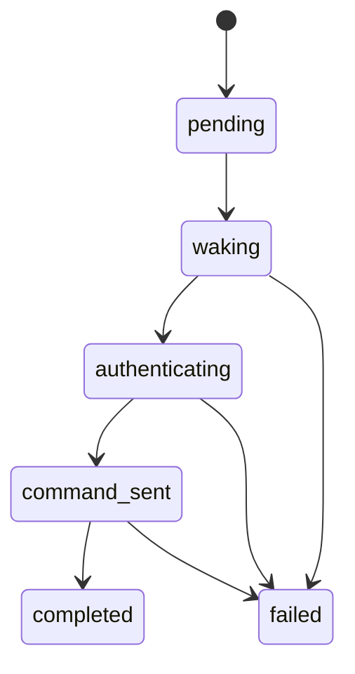

# Gateway, API e operações

O Gateway concentra cadastro, coordenação e transporte de eventos. Ele não executa o comando físico; essa responsabilidade pertence ao firmware.

## 1. Operações assíncronas

Ao receber um comando válido, a API chama `Submit` e responde 202. O Controller executa o ciclo em background e atualiza o estado da operação.

Os nomes exatos dos estados devem ser lidos no Controller e no dashboard. O SSE comunica transições relevantes ao navegador.

## 2. Identificadores

| Campo | Duração | Finalidade |
|---|---|---|
| `op_id` | Toda a operação, incluindo retries | Correlacionar intenção e resultado |
| `session_id` | Uma tentativa | Isolar autenticação e conexão |
| `command_id` | Um Command e seu Result | Igual ao `op_id` no fluxo atual |

## 3. Eventos SSE

A rota `/api/events` envia eventos de operação. O dashboard os utiliza para atualizar estados, histórico e telemetria.

O canal de eventos possui buffer de 256. Em sobrecarga, eventos podem ser descartados para não bloquear o Controller.

## 4. Registry e secrets

A listagem pública de agentes não devolve a secret. O cadastro recebe a secret em Base64 e armazena os bytes decodificados.

O arquivo real `configs/registry.json` contém dados operacionais e está no `.gitignore`.

## 5. Dashboard incorporado

`embed.FS` inclui os arquivos estáticos no binário. Isso permite distribuir Gateway e dashboard sem um servidor web separado.

## 6. Cliente CLI

`cmd/client` chama a API REST. O endereço padrão é `http://localhost:18080`; para uso remoto, o código precisa ser ajustado e recompilado.
