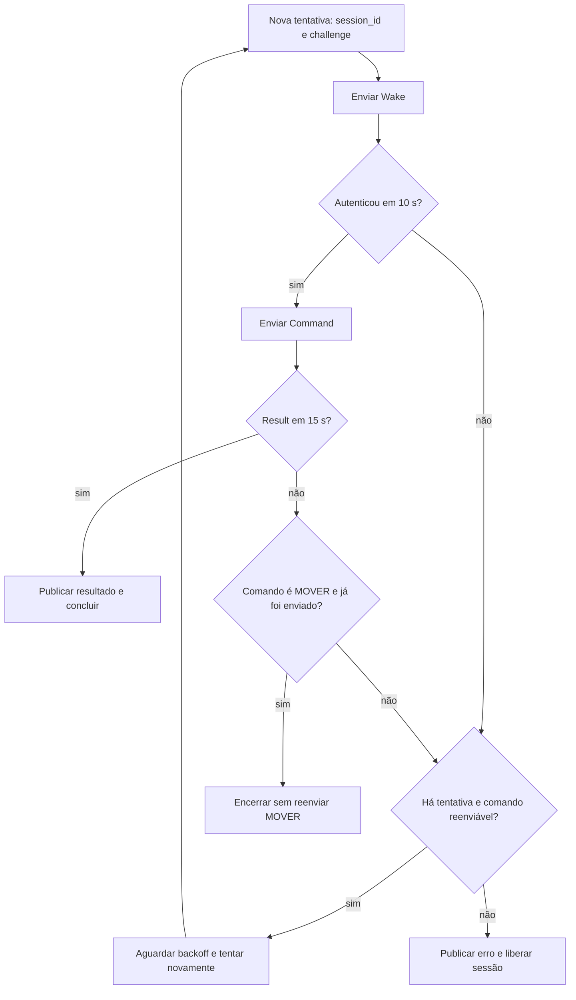

[← Índice da documentação](README.md)

# 8. Confiabilidade, timeouts e retries

> **Pergunta central:** O que acontece quando a conversa não avança? O
> sistema utiliza tempos máximos, novas tentativas e uma regra
> específica para comandos que podem alterar o estado físico.

## 8.1 Cada espera possui um limite

Uma operação distribuída pode parar em diferentes pontos. Por isso, o
projeto não utiliza uma espera única e indefinida. O Controller, o
handler e o firmware possuem limites próprios, adequados à etapa que
controlam.

**Tabela 11 — Tempos empregados na coordenação**

| Local             | Espera ou varredura           | Valor   | Efeito                                     |
|-------------------|-------------------------------|---------|--------------------------------------------|
| Controller        | Autenticação da sessão        | 10 s    | Encerra a tentativa e avalia retry.        |
| Controller        | Result após o Command         | 15 s    | Aplica a regra de resultado ausente.       |
| WebSocket Handler | Timer geral após autenticação | 30 s    | Evita conexão autenticada sem progresso.   |
| Ephemeral Store   | TTL da sessão                 | 60 s    | Marca sessões antigas para remoção.        |
| Ephemeral Store   | Intervalo de limpeza          | 30 s    | Remove sessões expiradas.                  |
| Agente 03         | Estado ACK                    | Até 5 s | Encerra com Bye por timeout se necessário. |

## 8.2 A política de novas tentativas

O Controller realiza até cinco tentativas. O backoff nominal entre elas
é de 0, 1, 2, 4 e 8 segundos. Cada tentativa recebe novo `session_id` e
novo challenge, preservando o `op_id`. A renovação impede que a próxima
tentativa dependa de credenciais efêmeras da anterior.

**Figura 14** — Decisão de retry. O identificador da operação permanece,
mas a tentativa muda. MOVER recebe tratamento conservador depois que o
Command foi enviado.

## 8.3 Por que MOVER não é reenviado após a perda do Result

Ler um sensor pode ser repetido sem alterar a grandeza medida. Mover um
motor, por outro lado, muda a posição física. Se o Command foi entregue
e apenas o Result se perdeu, repetir MOVER poderia produzir um segundo
deslocamento, embora a intenção original fosse única.

Por isso, `MOVER` pertence ao conjunto de comandos não idempotentes do
Controller. Depois de `command_sent`, a ausência de Result não provoca
reenvio desse comando. A regra privilegia a previsibilidade do atuador
em vez da simples insistência na comunicação.

> **Idempotência, em linguagem direta:** Uma operação idempotente pode
> ser repetida sem acrescentar um novo efeito a cada repetição. Um
> movimento incremental não possui essa propriedade: duas execuções de
> 200 passos podem deslocar 400 passos.

## 8.4 Estados da operação e eventos

A interface acompanha a transição entre criação, convocação,
autenticação, envio, resultado e erro. Esses estados descrevem a
operação lógica, enquanto a sessão possui seu próprio ciclo. Separar os
dois permite representar retries sem perder a identidade da intenção.

**Tabela 12 — Leitura dos eventos mais frequentes**

| Evento                  | Informação carregada                        | Uso no dashboard                                      |
|-------------------------|---------------------------------------------|-------------------------------------------------------|
| `command_created`       | Operação aceita e identificadores iniciais. | Abre acompanhamento e registra a intenção.            |
| `wake_sent` / `auth_ok` | Progresso da tentativa.                     | Atualiza histórico e disponibilidade.                 |
| `command_sent`          | Command escrito no WebSocket.               | Informa que a execução foi solicitada.                |
| `result_received`       | Resultado, operação, agente e comando.      | Entrega dados ao parser e finaliza a espera.          |
| Evento de erro          | Motivo e contexto da operação.              | Encerra a espera sem criar amostra numérica inválida. |

## 8.5 Watchdog e manutenção do agente

A confiabilidade também aparece no firmware. O Agente 01 monitora Wi-Fi,
renova a escuta UDP, acompanha heap e utiliza watchdog de 15 s, além de
reboot preventivo. O objetivo é recuperar o serviço básico de escuta e
evitar que condições transitórias deixem o dispositivo preso fora do
ciclo STANDBY–Wake.

Esses mecanismos atuam em camadas diferentes: timeouts delimitam
esperas, retries repetem intenções permitidas, cleanup libera sessões e
watchdog recupera o firmware. Em conjunto, eles sustentam o caráter
episódico da conexão.

## Código e referências relacionadas

- [Retries e estados](../internal/controller/controller.go)
- [TTL e limpeza](../internal/session/session.go)

---

[Voltar ao índice da documentação](README.md)
