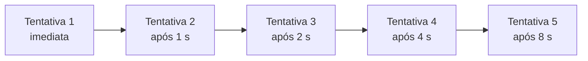

# Timeouts, retries e concorrência

A comunicação combina UDP, WebSocket e espera assíncrona. Timeouts e regras de reenvio evitam espera indefinida.

## 1. Valores implementados

| Etapa | Valor |
|---|---|
| Tentativas máximas | 5 |
| Backoff nominal | 0, 1, 2, 4 e 8 segundos |
| Espera por autenticação | 10 segundos |
| Espera por Result | 15 segundos |
| TTL da sessão | 60 segundos |
| Limpeza de sessões | A cada 30 segundos |
| Timer geral WebSocket | 30 segundos |
| Watchdog visual do dashboard | 150 segundos |

O primeiro envio não aguarda backoff. Os valores nominais de espera entre tentativas formam a sequência apresentada; a implementação deve ser consultada para detalhes de scheduling.

## 2. Backoff exponencial

Cada tentativa renova sessão e challenge, preservando o `op_id`.

## 3. Canais com buffer um

`authCh` e `resultCh` têm capacidade um. Isso evita acúmulo ilimitado de notificações para uma operação e torna explícita a entrega entre handler e Controller.

## 4. Comandos não idempotentes

`MOVER` pode produzir movimento físico. Depois que o Command foi enviado, a ausência de Result não significa que o agente não executou. Reenviar poderia duplicar o movimento.

Por isso, após `command_sent`, a perda do Result não provoca nova tentativa automática de `MOVER`.

## 5. Watchdog visual

O dashboard destaca operações antigas após 150 segundos. Esse watchdog não cancela necessariamente a goroutine nem o hardware; é uma sinalização de interface.

## 6. Consequência prática

Timeout de rede e estado físico são coisas diferentes. Uma interface pode mostrar falha enquanto o motor continua girando. `PARE` deve ser usado conforme a disponibilidade do agente e as regras da bancada.
