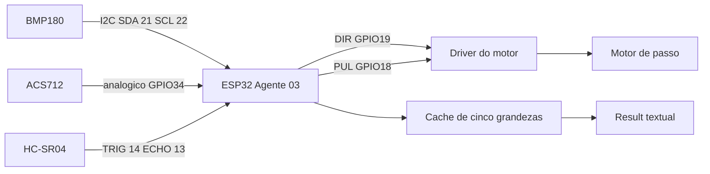
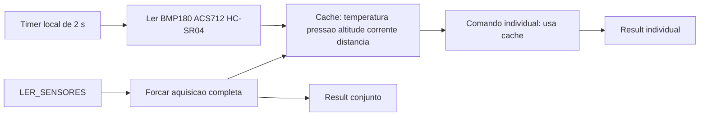
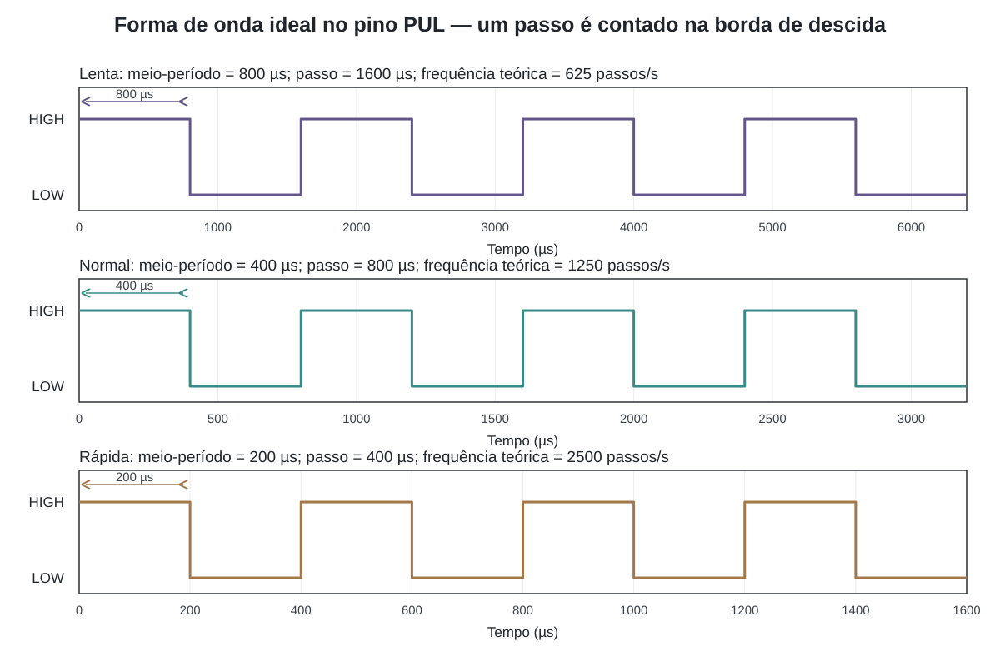

[← Índice da documentação](README.md)

# 9. Firmwares e integração com o hardware

> **Neste capítulo:** A mesma arquitetura de rede é aplicada a dois
> experimentos. Primeiro aparece o Agente 01, de complexidade reduzida;
> depois, o Agente 03 combina sensores, cache e motor de passo.

## 9.1 Um protocolo comum, comportamentos físicos diferentes

O Gateway não carrega regras específicas de LED, temperatura ou motor.
Essas regras ficam no firmware. Por isso, os agentes compartilham Wake,
Hello, sessão e Result, mas executam capabilities diferentes. O Agente
01 demonstra o ciclo com um LED no GPIO2; o Agente 03 demonstra a
integração com cinco grandezas e um atuador.

### Agente 01: demonstração e manutenção de longa duração

O firmware V4.3-MARATHON implementa `LED_ON` e `LED_OFF`. Depois de
validar o Command, altera o GPIO2 e responde com um Result textual. Sua
simplicidade torna visível todo o percurso do protocolo sem exigir
interpretação de sensores.

Esse sketch também reúne verificações de Wi-Fi, renovação do socket UDP,
monitoramento de heap, watchdog de 15 s e reboot preventivo. Esses
recursos preservam a disponibilidade do agente e reforçam o retorno ao
estado de escuta depois de cada sessão.

### Agente 03: aquisição e movimento no mesmo loop

O firmware V4.4 combina três atividades: a máquina de estados da rede,
um cache de sensores atualizado periodicamente e um gerador não
bloqueante de pulsos. O loop verifica Wi-Fi, atualiza sensores e motor e
executa o handler do estado de rede. A atividade física, portanto, não
depende da permanência do WebSocket.

**Figura 15** — Integração elétrica e lógica do Agente 03. A numeração
corresponde aos GPIOs definidos no firmware; o driver e a alimentação
seguem o projeto elétrico da bancada.

**Tabela 13 — Pinagem e tratamento dos periféricos**

| Elemento               | Ligação ou parâmetro                      | Tratamento no firmware                                                         |
|------------------------|-------------------------------------------|--------------------------------------------------------------------------------|
| BMP180                 | SDA GPIO21; SCL GPIO22.                   | Biblioteca Adafruit_BMP085; temperatura e pressão lidas, altitude calculada.   |
| Referência barométrica | `PRESSAO_NIVEL_MAR = 102360 Pa`.          | Parâmetro da função de altitude; a altitude absoluta depende dessa referência. |
| ACS712                 | Saída analógica no GPIO34; modelo de 5 A. | 64 amostras, ADC de 12 bits e conversão para tensão de 3,3 V.                  |
| Calibração de corrente | Zero 1,406 V; sensibilidade 0,185 V/A.    | `I = (V − 1,406) / 0,185`.                                                     |
| HC-SR04                | TRIG GPIO14; ECHO GPIO13.                 | Pulso de 10 µs; `pulseIn` com timeout de 30 ms.                                |
| Motor                  | DIR GPIO19; PUL GPIO18.                   | Saídas iniciam em LOW; pulsos atualizados no loop cooperativo.                 |

## 9.2 Como os sensores chegam ao cache

Uma leitura conjunta acontece no setup e, depois, todo o cache é
atualizado a cada 2 s. O comando `LER_SENSORES` força uma nova aquisição
completa antes de responder. As capabilities individuais devolvem o
valor atualmente em cache, sem realizar uma nova medição naquele
instante.

**Figura 16** — Ciclo de aquisição. O cache é local ao ESP32 e não é
transmitido espontaneamente; somente um Command produz um Result para o
Gateway.

**Tabela 14 — Contrato textual das leituras**

| Capability     | Origem                               | Exemplo de `stdout`                             | Condição de interpretação             |
|----------------|--------------------------------------|-------------------------------------------------|---------------------------------------|
| `LER_SENSORES` | Aquisição nova de todos os sensores. | `TEMPERATURA=23.45 C | PRESSAO=101325 Pa | ...` | Distância sem eco aparece como `NA`.  |
| `TEMPERATURA`  | Cache.                               | `23.45 C`                                       | Unidade esperada: C.                  |
| `PRESSAO`      | Cache.                               | `101325 Pa`                                     | O dashboard converte Pa para hPa.     |
| `ALTITUDE`     | Cálculo sobre o cache.               | `28.10 m`                                       | Depende da pressão de referência.     |
| `CORRENTE`     | Cache.                               | `0.123 A`                                       | Depende do zero, sensibilidade e ADC. |
| `DISTANCIA`    | Cache.                               | `35.2 cm`                                       | Sem eco: `stderr` explicativo.        |

No JSON e no `stdout`, o separador decimal é o ponto. A conversão da
corrente segue a tensão medida no ADC:

    tensao   = bruto × (3.3 / 4095)
    corrente = (tensao − ZERO_CORRENTE) / SENSIBILIDADE_ACS712

No HC-SR04, a duração representa ida e volta do pulso sonoro; por isso,
a distância divide o percurso por dois:

    distância (cm) = duração (µs) × 0,034 / 2

## 9.3 START, PARE e MOVER

O motor possui três comandos com semânticas distintas. `START` inicia
giro contínuo para a direita, na velocidade normal. `PARE` coloca PUL em
LOW e zera o estado de movimento. `MOVER` configura um deslocamento
finito com direção, quantidade de passos e velocidade.

**Tabela 15 — Semântica dos comandos do motor**

| Comando | Efeito                                                    | O que o Result confirma | Como o movimento termina                        |
|---------|-----------------------------------------------------------|-------------------------|-------------------------------------------------|
| `START` | Giro contínuo, direção “direita”, meio-período de 400 µs. | Início do movimento.    | `PARE` ou limite de 60 s.                       |
| `PARE`  | PUL em LOW e estado de movimento zerado.                  | Execução da parada.     | Imediato na lógica do firmware.                 |
| `MOVER` | Movimento finito com argumentos validados.                | Início, não conclusão.  | Passos esgotados, `PARE`, novo comando ou 60 s. |

A função de atualização alterna PUL quando `micros()` ultrapassa o
meio-período configurado. Em MOVER, a contagem decresce na borda de
descida: um passo corresponde a um ciclo HIGH + LOW. Ao chegar a zero, o
firmware interrompe os pulsos e registra a conclusão no Serial, sem
criar um novo evento para o Gateway.

## 9.4 Da temporização à velocidade

Um ciclo completo contém dois meio-períodos. A frequência aproximada de
passos e o tempo ideal de um movimento finito podem ser estimados pelas
relações:

    fpassos ≈ 1 / (2 × meio-período)    |    testimado = passos × 2 × meio-período

**Figura 17** — Formas de onda ideais no pino PUL para os três perfis de velocidade.

**Tabela 16 — Velocidades nominais e exemplo de duração**

| Perfil | Meio-período | Passos por segundo | Tempo ideal para 200 passos |
|--------|--------------|--------------------|-----------------------------|
| Lenta  | 800 µs       | ≈ 625              | 0,32 s                      |
| Normal | 400 µs       | ≈ 1250             | 0,16 s                      |
| Rápida | 200 µs       | ≈ 2500             | 0,08 s                      |

Com 30000 passos na velocidade lenta, a estimativa ideal é 48 s, abaixo
do limite de 60 s. O deslocamento angular real depende do motor, do
driver e do microstepping. Como não há realimentação de posição, o
firmware conhece a contagem de pulsos solicitada, não uma posição
absoluta medida.

> **Ponto de integração:** O protocolo entrega a intenção; o firmware
> transforma essa intenção em leitura, nível lógico ou sequência de
> pulsos. O cache e o motor continuam sendo responsabilidades locais do
> agente.

## Código e referências relacionadas

- [Firmware do Agente 01](../agents/esp32/esp32_agent.ino.ino)
- [Firmware do Agente 03](../agents/esp32/agente03/agente03.ino)

---

[Voltar ao índice da documentação](README.md)
