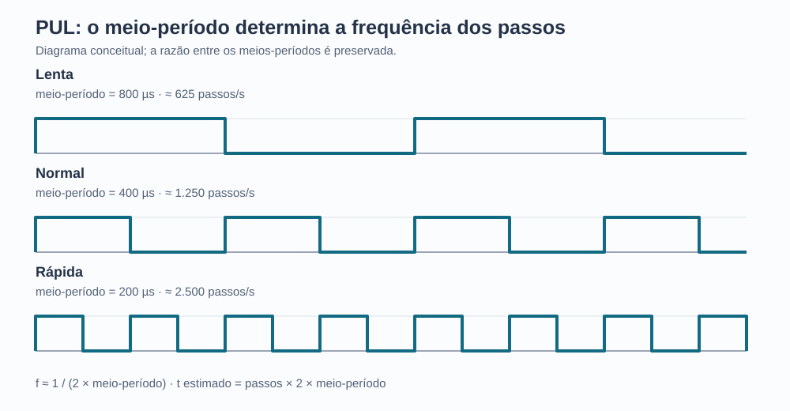

# Firmware e hardware

O repositório contém dois firmwares de referência. Eles compartilham o protocolo, mas possuem hardware e comandos diferentes.

## 1. Agente 01

Arquivo: `agents/esp32/esp32_agent.ino.ino`.

- Firmware V4.3-MARATHON.
- LED no GPIO 2.
- Comandos `LED` e `STATUS`.
- UDP Wake e WebSocket temporário.

## 2. Agente 02

O Agente 02 aparece como cadastro de referência para polias industriais. Seu firmware não está incluído. Não se deve inferir pinagem, comando ou comportamento físico a partir do nome.

## 3. Agente 03

Arquivo: `agents/esp32/agente03/agente03.ino`.

| Recurso | Ligação |
|---|---|
| BMP180 SDA | GPIO 21 |
| BMP180 SCL | GPIO 22 |
| ACS712 | GPIO 34 |
| HC-SR04 TRIG | GPIO 14 |
| HC-SR04 ECHO | GPIO 13 |
| Motor DIR | GPIO 19 |
| Motor PUL | GPIO 18 |

Firmware V4.4, com `LER_SENSORES`, leituras individuais, `MOVER`, `STATUS`, `START` e `PARE`.

## 4. Cache de sensores

O cache é atualizado a cada dois segundos. `LER_SENSORES` força aquisição nova; comandos individuais utilizam o cache.

## 5. Conversões

Corrente:

```c
float tensao = bruto * (3.3f / 4095.0f);
corrente = (tensao - ZERO_CORRENTE) / SENSIBILIDADE_ACS712;
```

Distância:

```c
distancia = duracao * SOUND_SPEED / 2.0f;
```

Os resultados dependem de alimentação, calibração, fiação, sensor e ambiente. O código não constitui certificado metrológico.

## 6. Motor

| Velocidade | Meio-período | Aproximação |
|---|---:|---:|
| Lenta | 800 µs | 625 passos/s |
| Normal | 400 µs | 1.250 passos/s |
| Rápida | 200 µs | 2.500 passos/s |

```text
f_passos ≈ 1 / (2 × meio-período)
t_estimado = passos × 2 × meio-período
```



`MOVER` inicia pulsos em malha aberta. Não há encoder nem fim de curso no código. O Result confirma início, não conclusão física.

## 7. Rede e secrets

Os firmwares contêm placeholders para Wi-Fi. A secret demonstrativa deve ser substituída antes de uso. O IP do Gateway deve ser o endereço local correto.
