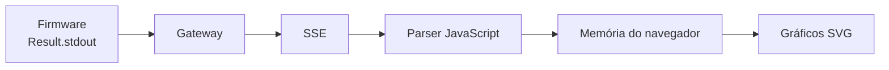

# Telemetria e gráficos

A telemetria do Tunneus é sob demanda. O navegador monta séries temporais a partir dos resultados das operações.

## 1. Pipeline

Não há banco de dados nesse caminho. O timestamp atribuído à amostra é o horário de recebimento no navegador.

## 2. Grandezas do Agente 03

| Grandeza | Origem | Comando agregado |
|---|---|---|
| Pressão | BMP180 | `LER_SENSORES` |
| Corrente | ACS712 | `LER_SENSORES` |
| Distância | HC-SR04 | `LER_SENSORES` |
| Passos | Contador do firmware | `LER_SENSORES` |
| Velocidade | Configuração/estado do motor | `LER_SENSORES` |

Leituras individuais também podem alimentar a grandeza correspondente.

## 3. Parser e deduplicação

O parser reconhece os formatos textuais produzidos pelo firmware. A deduplicação usa `op_id + grandeza`, evitando inserir a mesma leitura duas vezes quando eventos são reprocessados.

## 4. Retenção local

Cada grandeza mantém até 1.000 amostras e descarta dados com mais de 24 horas. Recarregar a página limpa as séries.

## 5. SVG

Os gráficos são gerados sem biblioteca externa. Eixos, escalas e pontos são recalculados no navegador.

## 6. Interpretação

- Uma linha contínua no gráfico não significa aquisição contínua.
- O intervalo entre amostras depende dos comandos enviados.
- Dados do mock são sintéticos.
- Dados históricos do caderno vêm da bancada real.
- O dashboard não corrige erros de calibração do sensor.
