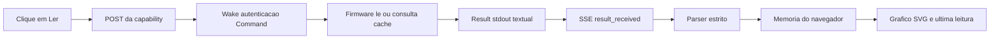
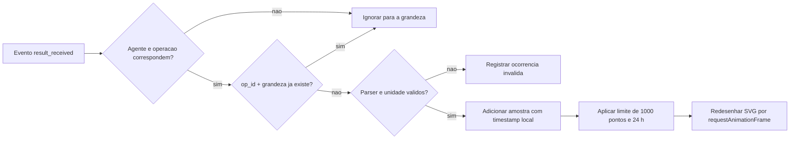

[← Índice da documentação](README.md)

# 10. Telemetria: do sensor ao gráfico

> **Neste capítulo:** O percurso de uma grandeza é separado em
> aquisição, transporte, interpretação e apresentação. Essa separação
> explica por que o sistema possui telemetria sob demanda, embora o
> firmware atualize seu cache periodicamente.

## 10.1 Sob demanda, não em streaming contínuo

O ESP32 atualiza o cache a cada 2 s, mas não envia esses valores
espontaneamente ao Gateway. Uma amostra chega ao navegador apenas quando
uma capability de leitura é solicitada e o Result correspondente
retorna. Não existe, nesta versão, um produtor contínuo de telemetria
nem um banco de dados de séries temporais.

**Figura 18** — Caminho completo da medição. O sensor e o relógio de
aquisição ficam no ESP32; a interpretação e o histórico visual ficam no
navegador.

Além das grandezas físicas, os eventos SSE formam uma telemetria
operacional: descrevem criação, Wake, autenticação, envio, resultado e
erro. Assim, o painel apresenta tanto o valor medido quanto o caminho
percorrido pela operação.

## 10.2 O parser preserva o contrato

O Result é textual e precisa ser interpretado sem ambiguidade. Para
leituras individuais, o dashboard aceita um número decimal seguido da
unidade esperada: `C`, `Pa`, `m`, `A` ou `cm`. Para `LER_SENSORES`,
separa os campos por `|` e depois cada par por `=`.

Pressão chega em Pa e é convertida para hPa somente na apresentação.
Distância `NA`, valor negativo ou unidade inesperada não substitui a
última leitura válida. Uma ocorrência com `stderr` pode ser preservada
como marca inválida, mantendo a diferença entre “sem nova amostra” e
“nova amostra válida”.

**Tabela 17 — Transformações aplicadas no navegador**

| Entrada                       | Verificação                       | Saída visual                                  |
|-------------------------------|-----------------------------------|-----------------------------------------------|
| `23.45 C`                     | Número e unidade C.               | 23,45 °C na apresentação.                     |
| `101325 Pa`                   | Número e unidade Pa.              | 1013,25 hPa após conversão.                   |
| `35.2 cm`                     | Número não negativo e unidade cm. | Amostra de distância.                         |
| `DISTANCIA=NA`                | Ausência de eco.                  | Ocorrência inválida; não vira ponto numérico. |
| Unidade diferente da esperada | Incompatibilidade de contrato.    | Resultado não é aceito como grandeza válida.  |

## 10.3 O ciclo de vida de uma amostra

O dashboard guarda as amostras na memória da página. Cada ponto recebe o
instante de recebimento no navegador, pois o firmware não envia
timestamp nem sincronização NTP. A chave `op_id + grandeza` impede que
um evento repetido duplique o ponto.

**Figura 19** — Ciclo da amostra no navegador. Filtragem, deduplicação e
validação ocorrem antes da atualização do gráfico.

**Tabela 18 — Retenção e apresentação do histórico**

| Aspecto              | Comportamento                                                                     |
|----------------------|-----------------------------------------------------------------------------------|
| Retenção             | Até 1000 amostras por grandeza e até 24 h, o que ocorrer primeiro.                |
| Janelas dos gráficos | 15 min, 1 h, 6 h e 24 h.                                                          |
| Desatualização       | Última amostra com mais de 5 min é sinalizada.                                    |
| Persistência         | Não há persistência; recarregar a página apaga amostras, operações e logs locais. |
| Reconexão            | EventSource reconecta o SSE; polling do Registry continua em paralelo.            |

> **Duas frequências diferentes:** O cache físico é atualizado pelo
> firmware; o histórico visual avança quando uma leitura é solicitada e
> confirmada. Confundir esses dois ciclos daria a impressão de streaming
> que a arquitetura atual não possui.

## Código e referências relacionadas

- [Dashboard e parser](../web/dashboard/index.html)

---

[Voltar ao índice da documentação](README.md)
