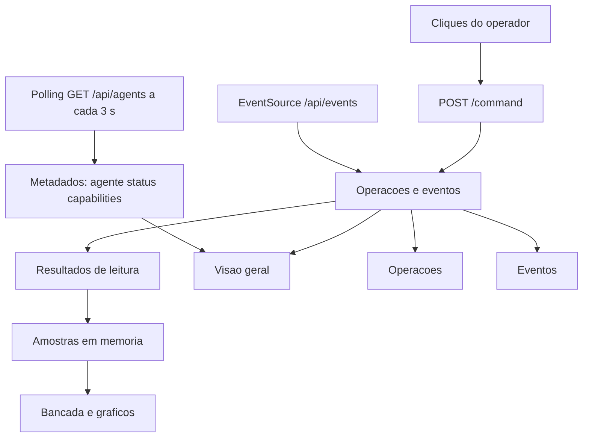
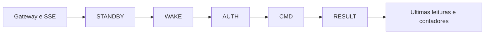
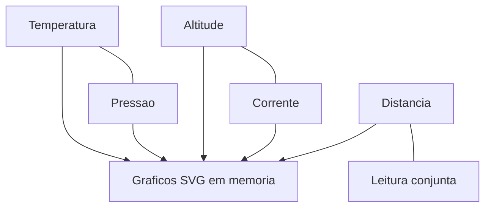
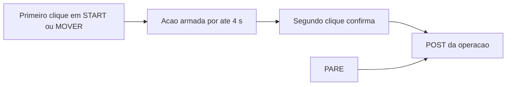

[← Índice da documentação](README.md)

# 11. Dashboard: a arquitetura vista pelo operador

> **Neste capítulo:** A interface é apresentada como uma composição dos
> conceitos anteriores: Registry, operações, eventos, amostras e
> controles físicos. Os diagramas seguintes organizam os elementos
> apresentados pelo painel executado com o mock local do projeto.

## 11.1 Uma SPA sem dependências externas

O dashboard v5.1 é uma Single Page Application em um único arquivo HTML
com CSS e JavaScript inline. Não utiliza bibliotecas nem CDN, escolha
compatível com o funcionamento em rede local. Os gráficos SVG são
construídos por funções próprias, e a renderização incremental usa flags
de sujeira e `requestAnimationFrame`.

As quatro visões — **Visão geral**, **Bancada**, **Operações** e
**Eventos** — organizam o mesmo estado sob perspectivas diferentes. A
navegação usa hash, aceita teclado, declara roles ARIA e se adapta a
telas estreitas. `ResizeObserver` recalcula a largura dos gráficos.

**Figura 20** — Planos de dados do dashboard. REST atualiza metadados e
envia intenções; SSE acompanha operações; o histórico de amostras nasce
somente dos Results válidos.

## 11.2 Visão geral: o estado da sessão

A visão geral reúne metadados do agente, conectividade do Gateway e do
SSE, últimas leituras válidas, pontos de atenção e contadores locais. A
linha STANDBY → WAKE → AUTH → CMD → RESULT avança somente quando o
evento correspondente chega; não há animação que simule progresso por
tempo.

**Figura 21** — Organização da visão geral: conectividade, etapas da
sessão e resumo das grandezas.

O painel diferencia indisponibilidade do Gateway, SSE desconectado,
agente ausente, capabilities desconhecidas, status unreachable e falha
da última operação. Esses sinais evitam reduzir todo o estado do sistema
a um único indicador “online/offline”.

## 11.3 Bancada: grandezas e histórico

A visão Bancada apresenta cinco grandezas: temperatura, pressão,
altitude, corrente e distância. Cada cartão contém última leitura
válida, indicação de atualização, controle de leitura e gráfico. A
leitura conjunta preenche os campos disponíveis, enquanto leituras
individuais atualizam apenas a grandeza solicitada.

**Figura 22** — Cinco grandezas da bancada e seus históricos visuais,
alimentados por Results sob demanda.

Não existe polling periódico de sensores. O polling de três segundos
consulta `/api/agents` para metadados; as amostras são criadas por ações
de leitura e eventos de Result. Essa distinção mantém previsível a carga
de comunicação com o experimento.

## 11.4 Controles do motor e confirmação intencional

START e MOVER exigem dois cliques em até quatro segundos. O primeiro
clique arma a ação e informa o que será executado; o segundo confirma.
PARE é imediato, respeitando a disponibilidade da operação. A diferença
de interação combina proteção contra acionamento acidental com acesso
rápido à parada.

**Figura 23** — Interação dos controles de movimento: confirmação em
dois cliques para START e MOVER e acesso imediato a PARE.

Para MOVER, o painel calcula uma estimativa a partir dos passos e do
perfil de velocidade, acrescentando margem visual de 1,5 s. Como o
firmware não publica a conclusão do movimento, a interface não deve
apresentar o Result inicial como “movimento concluído”.

## 11.5 Operações, eventos e watchdog visual

A visão Operações organiza intenções e desfechos pelo `op_id`; Eventos
preserva a sequência recebida por SSE. Operações que permanecem sem
desfecho são acompanhadas por um watchdog visual de 150 s, que consulta
o estado em vez de inventar uma conclusão local.

**Tabela 19 — Como a interface representa os conceitos do sistema**

| Conceito                    | Representação no dashboard                               |
|-----------------------------|----------------------------------------------------------|
| Registry                    | Identidade, status e capabilities do agente selecionado. |
| Operação assíncrona         | Cartões e histórico identificados por `op_id`.           |
| Pico de Conexão             | Etapas WAKE, AUTH, CMD e RESULT.                         |
| Telemetria sob demanda      | Última leitura e gráfico alimentados por Results.        |
| Movimento sem realimentação | Estimativa visual e distinção entre início e conclusão.  |

**A arquitetura permanece visível:** o dashboard mostra quem foi
selecionado, em que etapa a sessão está, qual resultado chegou e quais
limites de confirmação existem.

## Código e referências relacionadas

- [SPA do dashboard](../web/dashboard/index.html)
- [Documento original do dashboard](DASHBOARD_AGENTE03.md)

---

[Voltar ao índice da documentação](README.md)
