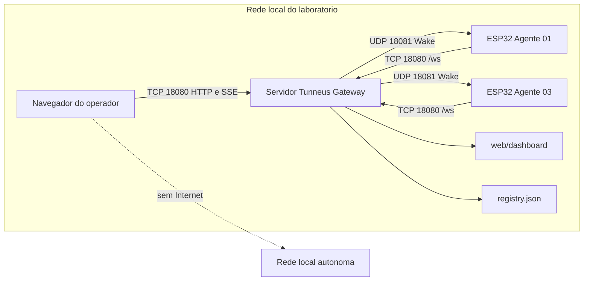

[← Índice da documentação](README.md)

# 12. API, implantação e diagnóstico

> **Neste capítulo:** Os conceitos passam a ser usados de forma prática:
> consultar a API, preparar o Registry, executar o Gateway e localizar a
> camada correspondente a cada sintoma.

## 12.1 Rotas públicas

A API reúne poucas rotas, cada uma ligada a uma responsabilidade
arquitetural. O navegador usa REST para listar agentes, submeter
comandos e consultar operações; o SSE distribui os marcos; a rota `/ws`
é destinada ao agente, não ao dashboard.

**Tabela 20 — Rotas expostas pelo Gateway**

| Método e rota                   | Resposta                 | Finalidade                                                  |
|---------------------------------|--------------------------|-------------------------------------------------------------|
| `GET /`                         | Texto simples.           | Retorna “Tunneus Gateway Online”.                           |
| `GET /health`                   | JSON.                    | Informa processo online e versão.                           |
| `GET /api/agents`               | 200, lista JSON.         | Apresenta a visão pública dos agentes, sem secret e sem IP. |
| `POST /api/agents/{id}/command` | 202 ou erro de contrato. | Valida e cria uma operação assíncrona.                      |
| `GET /api/operations/{id}`      | 200 ou 404.              | Consulta o estado da operação.                              |
| `GET /api/events`               | `text/event-stream`.     | Publica os eventos para clientes conectados.                |
| `GET /dashboard/`               | Arquivos estáticos.      | Serve o dashboard v5.1.                                     |
| `/ws`                           | Upgrade WebSocket.       | Recebe Hello e demais mensagens do agente.                  |

### Exemplo de submissão

    POST /api/agents/esp32-03/command
    Content-Type: application/json

    {"cmd":"MOVER","args":{"dir":"direita","steps":200,"speed":"normal"}}

    HTTP/1.1 202 Accepted
    {
      "success": true,
      "op_id": "UUID",
      "agent_id": "esp32-03",
      "command": "MOVER",
      "status": "pending"
    }

O campo `op_id` permite consultar `/api/operations/{id}`. O
acompanhamento recomendado é pelo SSE, pois os eventos comunicam as
transições assim que ocorrem. As operações ficam em memória, com
retenção aproximada de 30 min, e não sobrevivem ao reinício do processo.

## 12.2 Topologia de implantação

Uma instalação típica reúne navegador, Gateway e agentes na mesma rede
local roteável. O Gateway escuta TCP 18080 para HTTP, SSE, dashboard e
WebSocket; os agentes escutam UDP 18081 para Wake. O endereço usado no
firmware é o do Gateway, enquanto o Registry mantém o último IP
conhecido de cada agente.

**Figura 24** — Topologia de implantação. O navegador nunca precisa
conhecer o IP do ESP32; o agente, por sua vez, conhece o endereço do
Gateway para abrir o WebSocket.

## 12.3 Preparação por etapas

1.  **Ambiente do Gateway.** Utilizar Go compatível com o `go.mod`, que
    declara Go 1.24.4, e obter as dependências do módulo.
2.  **Ambiente do firmware.** Preparar Arduino IDE 2.x, suporte ao ESP32
    DevKit, ArduinoWebsockets, ArduinoJson 6.x e Adafruit BMP085 para o
    Agente 03.
3.  **Registry.** Definir identificador único, secret forte em Base64,
    IP alcançável, nome e capabilities exatas. Não reutilizar secrets de
    demonstração.
4.  **Firmware.** Configurar SSID, senha, IP do Gateway, identidade e
    bytes da secret. Conferir pinagem, alimentação, referência
    barométrica, calibração do ACS712 e sentido de DIR.
5.  **Rede.** Liberar TCP 18080 e UDP 18081 conforme a topologia.
    Verificar no Serial o IP, RSSI, bind UDP e inicialização do BMP180.
6.  **Execução.** Compilar o ponto de entrada atual, iniciar o Gateway e
    abrir `http://IP_DO_GATEWAY:18080/dashboard/`.

&nbsp;

    cd /raiz/do/repositorio
    go mod tidy
    go vet ./cmd/gateway ./internal/...
    go build -o tunneus-gateway ./cmd/gateway
    ./tunneus-gateway

O build é direcionado a `./cmd/gateway`. O diretório `cmd/client`
preserva um componente histórico da V3 e não integra o executável atual.

### Exemplos de operação programática

    # Listar agentes
    curl http://localhost:18080/api/agents

    # Solicitar leitura conjunta
    curl -X POST http://localhost:18080/api/agents/esp32-03/command \
      -H 'Content-Type: application/json' \
      -d '{"cmd":"LER_SENSORES"}'

    # Consultar a operação retornada
    curl http://localhost:18080/api/operations/OP_ID

## 12.4 Diagnóstico orientado pelo fluxo

Em vez de tratar qualquer sintoma como “o sistema não funciona”, o
diagnóstico acompanha a última etapa conhecida. HTTP 400 aponta para
contrato ou capability; ausência de autenticação desloca a atenção para
Wake, rede ou secret; Result válido sem gráfico desloca a análise para
SSE, parser e janela temporal.

**Tabela 21 — Sintomas e verificações por camada**

| Sintoma                       | Camada provável             | Verificação orientada                                                     |
|-------------------------------|-----------------------------|---------------------------------------------------------------------------|
| 400 “comando não suportado”   | Registry / contrato.        | Conferir grafia e presença da capability no agente.                       |
| Wake por IP desconhecido      | Cadastro de endereço.       | Obter o IP no Serial e atualizar `last_ip`.                               |
| `auth_timeout`                | Wake, rede ou autenticação. | Verificar UDP 18081, TCP 18080, logs e equivalência da secret.            |
| HMAC inválido no ESP          | Configuração criptográfica. | Comparar bytes decodificados, não as strings Base64 e HEX.                |
| SSE desconectado              | Canal de eventos.           | Acessar `/api/events` e observar a reconexão.                             |
| Gráfico vazio                 | Aquisição ou histórico.     | Solicitar leitura e verificar Results, parser e janela selecionada.       |
| Distância inválida            | Sensor ou interpretação.    | Verificar TRIG/ECHO, timeout de 30 ms e `stderr`/`NA`.                    |
| Motor parou após 60 s         | Proteção do firmware.       | Comportamento esperado; novo START/MOVER renova a janela.                 |
| `result_unconfirmed_no_retry` | Resultado não confirmado.   | MOVER já foi entregue; inspecionar a bancada e evitar reenvio automático. |

> **Método de diagnóstico:** Identifique a operação, observe o último
> evento e examine o componente responsável pela etapa seguinte. Os
> identificadores e eventos da arquitetura funcionam como instrumentos
> de rastreio.

## Código e referências relacionadas

- [Rotas HTTP](../internal/server/server.go)
- [API de agentes](../internal/api/agents.go)
- [Registry de exemplo](../configs/registry.example.json)

---

[Voltar ao índice da documentação](README.md)
