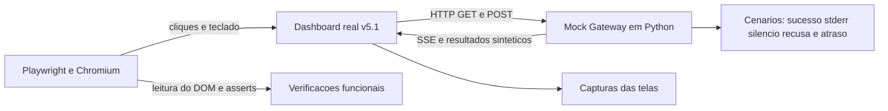

[← Índice da documentação](README.md)

# 13. Verificação funcional do sistema

> **Neste capítulo:** A verificação do dashboard é apresentada como uma
> reprodução controlada da arquitetura. O mock substitui somente o
> Gateway e os dispositivos, permitindo observar a interface sem acionar
> hardware real.

## 13.1 Evidências da bancada e evidências da simulação

O caderno de campo registra a evolução do Tunneus até a primeira versão
estável apresentada em feira. Os experimentos e dados históricos ali
documentados são provenientes da **bancada real**. Os protótipos, incluindo
o Agente 03, são aplicações de experimentação e teste do sistema; o
projeto central é o Tunneus.

O Mock Gateway tem outra finalidade: reproduzir contratos de software em
ambiente controlado. Seus valores são **sintéticos** e não representam
medições físicas. Essa separação permite apresentar a trajetória
experimental sem atribuir ao mock evidências que pertencem à bancada.

| Evidência | Origem | O que permite compreender |
|---|---|---|
| Caderno de campo | Experimentos e dados da bancada real. | Evolução do projeto, decisões e resultados experimentais. |
| Operação com agente físico | Respostas do firmware e do hardware. | Comunicação e comportamento da aplicação real. |
| Mock Gateway | Dados sintéticos controlados. | Interface, contratos REST/SSE, parser e gráficos. |

## 13.2 Por que utilizar um Mock Gateway

O repositório inclui `mock_gateway.py` e `test_dashboard.py`. O primeiro
reproduz rotas REST e eventos SSE; o segundo utiliza Playwright/Chromium
para operar o dashboard como um usuário. Essa combinação permite testar
o percurso visual completo sem depender de disponibilidade de rede,
sensores ou motor.

**Figura 25** — Arquitetura da verificação controlada. O HTML e o
JavaScript são os mesmos do projeto; somente o Gateway e os agentes são
simulados.

O mock produz cenários de sucesso, resposta rápida, `stderr`, silêncio,
recusa e resultado não confirmado. Situações que seriam demoradas ou
difíceis de provocar manualmente na bancada passam a ser repetíveis no
navegador.

## 13.3 O que é exercitado

**Tabela 22 — Cobertura funcional da verificação**

| Área                   | Comportamentos observados                                | Relação com a arquitetura                  |
|------------------------|----------------------------------------------------------|--------------------------------------------|
| Apresentação do agente | Metadados, capabilities, STANDBY e conexão.              | Registry e polling de metadados.           |
| Aquisição              | Leituras individuais e conjuntas, unidades, NA e Pa→hPa. | Result, parser e cinco grandezas.          |
| Histórico e gráficos   | Deduplicação, retenção, janelas e marcas inválidas.      | Telemetria visual sob demanda.             |
| Movimento              | START, PARE, MOVER, dois cliques e duração estimada.     | Operação física e confirmação intencional. |
| Operações e eventos    | HTTP 202, fases, watchdog, SSE e isolamento por agente.  | Modelo assíncrono e Pico de Conexão.       |
| Qualidade da interface | Acessibilidade, prevenção de XSS e largura de 390 px.    | Legibilidade e robustez da apresentação.   |

## 13.4 Resultado e interpretação

Na verificação controlada das cinco grandezas implementadas, o dashboard
concluiu 109 de 109 verificações contra o mock. O escopo foi concentrado
no conjunto presente no firmware e na interface, sem alterar o código do
projeto para produzir aprovações. Os diagramas de interface da
documentação do projeto foram derivados dessa verificação.

A suíte histórica `test_dashboard.py` também preserva expectativas de um cartão de fluxo ainda não implementado. O resultado de 109 verificações corresponde ao recorte controlado das cinco grandezas existentes, e não à execução direta e integral desse arquivo histórico.

O resultado demonstra a integração entre HTML, JavaScript, REST, SSE,
parser, estado local e gráficos em condições controladas. Os valores
exibidos são sintéticos. A verificação não substitui ensaios elétricos,
calibração de sensores, medição de formas de onda ou caracterização
metrológica da bancada física.

> **Fronteira da validação:** O mock verifica o comportamento da
> apresentação e dos contratos simulados. A bancada real é o ambiente
> adequado para verificar níveis elétricos, temporização, ruído,
> exatidão dos sensores e comportamento mecânico.

## Código e referências relacionadas

- [Mock Gateway](../tests/dashboard/mock_gateway.py)
- [Verificação com Playwright](../tests/dashboard/test_dashboard.py)

---

[Voltar ao índice da documentação](README.md)
