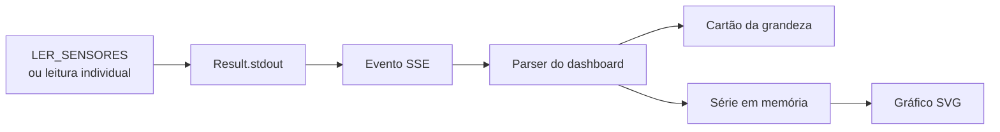

# Dashboard do Agente 03 — v5.1

O dashboard do Agente 03 é a visão de bancada do sistema Tunneus. Ele apresenta telemetria de pressão, corrente e distância, além do estado e do controle do motor de passo, em uma SPA servida pelo próprio Gateway.

> A bancada registra resultados da operação. Ela não substitui calibração de instrumentos, ensaio de segurança nem certificação metrológica.

## 1. Visão geral da interface

A interface atual mantém quatro visões:

- **Visão geral:** agentes cadastrados, conectividade e comandos disponíveis.
- **Bancada:** grandezas do Agente 03, histórico local e controle do motor.
- **Operações:** acompanhamento dos comandos assíncronos e de seus resultados.
- **Eventos:** histórico local dos eventos recebidos por SSE.

A Bancada utiliza cartões numéricos, gráficos SVG e indicadores de estado. Os gráficos são gerados pelo próprio JavaScript, sem bibliotecas externas, CDN ou etapa de build.

## 2. Da leitura ao gráfico

O fluxo começa com um comando solicitado pelo operador. O Gateway convoca o agente, recebe o `Result` e publica o evento correspondente. O dashboard interpreta o texto devolvido pelo firmware e cria uma amostra local.

A telemetria é **sob demanda**: não existe um streaming contínuo de sensores. O polling periódico de `/api/agents` atualiza informações dos agentes, não as leituras físicas.

## 3. Grandezas apresentadas

| Grandeza | Origem | Unidade apresentada | Observação |
|---|---|---|---|
| Pressão | BMP180 | hPa | Valor convertido pelo firmware |
| Corrente | ACS712 | A | Depende do zero e da sensibilidade configurados |
| Distância | HC-SR04 | cm | Medição por tempo de eco |
| Passos | Estado do firmware | passos | Contagem lógica de movimento |
| Velocidade | Configuração/estado do motor | passos/s | Não é medição por encoder |

`LER_SENSORES` realiza uma aquisição nova e retorna as cinco grandezas. Os comandos individuais de pressão, corrente e distância utilizam o cache mantido pelo firmware, atualizado a cada dois segundos.

## 4. Interpretação dos resultados

O protocolo transporta `stdout` e `stderr` como texto. O parser reconhece os formatos emitidos pelo firmware do Agente 03. Uma alteração nesses textos exige revisão conjunta do firmware e do dashboard.

A deduplicação usa a combinação `op_id + grandeza`. Isso evita que o reprocessamento de um mesmo evento duplique a amostra correspondente.

## 5. Retenção e timestamps

Cada grandeza mantém no máximo **1.000 amostras** e descarta pontos com mais de **24 horas**. Os dados ficam apenas na memória da página.

O timestamp usado no gráfico é o horário de recebimento no navegador. Ele não representa necessariamente o instante exato da conversão do sensor, pois inclui execução, transporte e entrega do evento.

Recarregar ou fechar a página elimina as séries locais. Para histórico permanente, seria necessária uma camada de persistência ainda não implementada.

## 6. Motor de passo

O controle de movimento utiliza os comandos `MOVER`, `START` e `PARE` conforme as capabilities do agente. `START` e `MOVER` possuem confirmação em dois cliques dentro de quatro segundos; `PARE` é enviado imediatamente quando a interface permite.

O firmware opera em malha aberta. O `Result` de `MOVER` confirma o início da geração de pulsos, não a chegada à posição final. O encerramento do WebSocket não interrompe necessariamente os pulsos já programados.

## 7. Operações e watchdog

O acompanhamento por `op_id` permite relacionar o pedido HTTP ao resultado SSE. A interface sinaliza operações que excedem o watchdog visual de 150 segundos.

Esse watchdog é uma indicação de interface, não uma garantia de cancelamento da goroutine ou da ação física. A perda de um `Result` também não prova que o motor não tenha se movido.

## 8. Proveniência dos dados

A mesma interface pode ser usada com o Gateway real ou com o mock. Essa distinção deve acompanhar qualquer demonstração:

| Fonte | Natureza dos valores |
|---|---|
| Agente físico | Resultado do firmware e do hardware |
| Mock Gateway | Valores sintéticos para teste de software |
| Registros históricos do caderno | Dados obtidos na bancada real |

O mock não valida BMP180, ACS712, HC-SR04, driver, GPIO ou comportamento mecânico.

## 9. Implementação

- `web/dashboard/index.html`: interface, parser, memória das séries e SVG.
- `tests/dashboard/mock_gateway.py`: servidor local de demonstração.
- `tests/dashboard/test_dashboard.py`: verificações históricas da interface.
- `agents/esp32/agente03/agente03.ino`: aquisição e formato dos resultados.

## 10. Limites de interpretação

Uma curva no gráfico representa os comandos executados e recebidos pelo navegador. Ela não implica amostragem contínua, sincronização precisa com o sensor ou correção de erros instrumentais.

A documentação das verificações deve distinguir o roteiro controlado de 109 verificações da suíte histórica completa, que contém expectativas de versões anteriores do dashboard.
