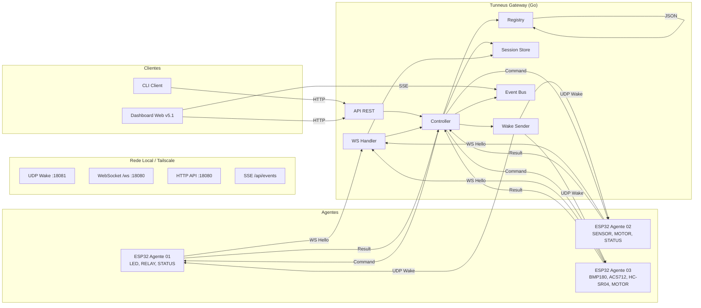
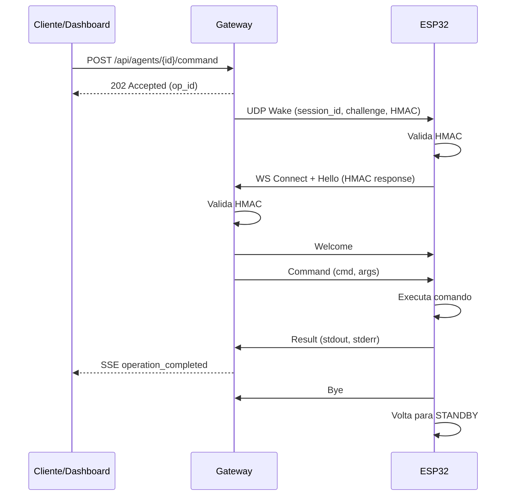

# SYSTEM_OVERVIEW.md — Tunneus Gateway

## Arquitetura de Alto Nível

## Fluxo de Operação

## Componentes

| Componente | Responsabilidade | Arquivo |
|---|---|---|
| API REST | Endpoints HTTP para clientes | `internal/api/agents.go` |
| Controller | Orquestra operações com retry | `internal/controller/controller.go` |
| Registry | CRUD de agentes + persistência JSON | `internal/registry/registry.go` |
| Session Store | Gerencia sessões temporárias | `internal/session/session.go` |
| Wake Sender | Envia pacotes UDP Wake | `internal/wake/wake.go` |
| WS Handler | Gerencia conexões WebSocket | `internal/websocket/handler.go` |
| Event Bus | Distribui eventos SSE | `internal/api/events.go` |
| Protocol | Tipos e parsing de mensagens | `internal/protocol/messages.go` |
| Dashboard | Interface web v5.1 com Bancada do Agente 03 | `web/dashboard/index.html` |
| CLI | Cliente de linha de comando | `cmd/client/main.go` |

## Portas

| Porta | Protocolo | Uso |
|---|---|---|
| 18080 | TCP/HTTP | API REST + Dashboard + WebSocket + SSE |
| 18081 | UDP | Wake packets |

## Dados Persistentes

- `configs/registry.json` — cadastro de agentes (ID, capabilities, secret hash, último IP)

## Dependências Externas

- `github.com/gorilla/websocket` — WebSocket server/client
- `github.com/google/uuid` — Geração de UUIDs

## Padrões de Projeto Utilizados

- **Registry Pattern** — cadastro centralizado de agentes
- **Session Store** — gerenciamento de sessões com TTL
- **Event Bus** — pub/sub interno para SSE
- **Retry with Backoff** — resiliência na comunicação
- **Graceful Shutdown** — encerramento limpo de recursos

## Decisões Arquiteturais (ADRs)

### ADR-001: Subagente Passivo + Pico de Conexão

**Contexto:** Agentes IoT com recursos limitados e intermitência de rede.
**Decisão:** O agente dorme em STANDBY com UDP aberto; o Gateway o acorda com um pacote Wake; o agente abre WebSocket, executa e desconecta.
**Alternativas rejeitadas:** WebSocket persistente (alto consumo), MQTT (requer broker), HTTP polling (latência).

### ADR-002: Autenticação HMAC-SHA256

**Contexto:** Comunicação em rede local potencialmente hostil.
**Decisão:** Challenge-response com HMAC-SHA256 e secret compartilhada por agente.
**Alternativas rejeitadas:** mTLS (complexidade de certificados), tokens JWT (stateless demais), sem autenticação (inseguro).

### ADR-003: JSON sobre WebSocket

**Contexto:** Protocolo legível, debugável e fácil de implementar no ESP32.
**Decisão:** Mensagens JSON tipadas via WebSocket.
**Alternativas rejeitadas:** Protobuf (complexidade), MessagePack (debug difícil), TCP raw (sem framing).

### ADR-004: Registry em JSON (sem banco de dados)

**Contexto:** Deploy simples sem dependências externas.
**Decisão:** Arquivo JSON com escrita atômica (tmp + rename).
**Alternativas rejeitadas:** SQLite (overhead), PostgreSQL (requer servidor), etcd (complexidade).

### ADR-005: Dashboard com SSE (não WebSocket)

**Contexto:** Dashboard precisa de atualizações em tempo real do Gateway.
**Decisão:** Server-Sent Events para push do servidor; REST para comandos do cliente.
**Alternativas rejeitadas:** WebSocket (bidirecional desnecessário), long polling (overhead HTTP).

### ADR-006: Retry com Backoff Exponencial

**Contexto:** Rede Wi-Fi instável; agentes podem não responder.
**Decisão:** 5 tentativas com backoff exponencial (1s, 2s, 4s, 8s, 16s) + jitter.
**Alternativas rejeitadas:** Retry imediato (sobrecarga), sem retry (frágil), retry infinito (travamento).

### ADR-007: Telemetria sob demanda com parser textual

**Contexto:** O Agente 03 devolve grandezas no Result e o dashboard precisa montar histórico sem um serviço adicional.
**Decisão:** Reutilizar `Result.stdout` e SSE; interpretar o texto no dashboard e manter séries apenas no navegador.
**Consequências:** Menor complexidade de infraestrutura, mas dependência do formato textual e perda do histórico ao recarregar.

### ADR-008: Dashboard v5.1 sem framework nem CDN

**Contexto:** A bancada precisa funcionar localmente com o mínimo de dependências.
**Decisão:** HTML, CSS e JavaScript puro, gráficos SVG e embed no binário Go.
**Consequências:** Execução sem Internet e sem build, com maior responsabilidade local sobre parser e apresentação.

### ADR-009: `MOVER` não é reenviado após `command_sent`

**Contexto:** A perda do Result não comprova que o movimento não começou.
**Decisão:** Não repetir automaticamente `MOVER` após o envio do Command apenas por timeout de Result.
**Consequências:** Reduz o risco de movimento duplicado, mas pode deixar a operação sem confirmação.

### ADR-012: Open Source

**Contexto:** Registro histórico complementar mantido neste documento.
**Decisão:** O Tunneus será desenvolvido como software livre.
**Consequências:** Comunidade pode contribuir, transparência total, adoção facilitada.

## Dashboard v5.1 e telemetria do Agente 03

A visão Bancada apresenta pressão, corrente, distância, passos e velocidade. As leituras chegam por Result e SSE, são interpretadas pelo parser do dashboard e alimentam gráficos SVG.

A retenção é de até 1.000 amostras e 24 horas por grandeza, somente na memória da página. O timestamp corresponde ao recebimento no navegador. O polling de `/api/agents` a cada três segundos não equivale a polling de sensores.

O mock Gateway produz dados sintéticos para verificar a interface. Dados históricos do caderno e resultados de agentes físicos pertencem a outra categoria de evidência: bancada real.

## Operação local e acesso remoto

O fluxo principal utiliza a rede local e não depende de Internet. Tailscale oferece acesso remoto privado já funcional, em processo de otimização, sem substituir o protocolo Tunneus.

## Direitos e distribuição

O repositório atual é privado e expositivo. O aviso de direitos reservados não concede licença open source; a distribuição futura ainda depende de decisão dos titulares.
